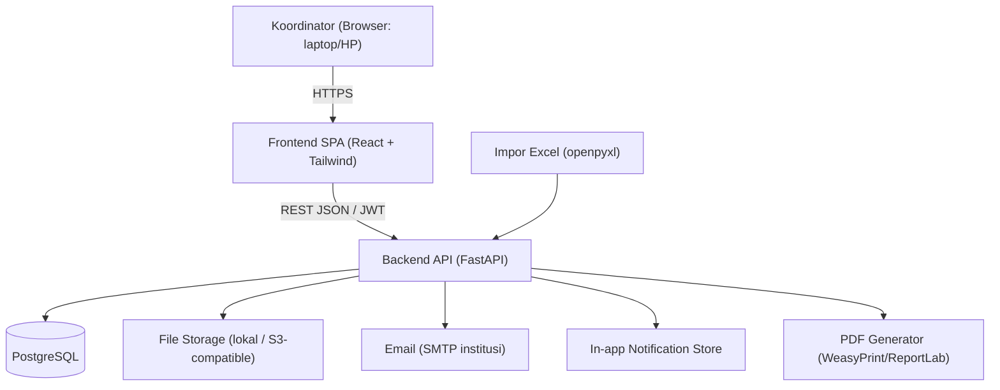

# HLD: LabOps ITG — Aplikasi Operasional Laboratorium Ilmu Komputer

> **Versi dokumen**: 1.0
> **Status**: Draf untuk review
> **Referensi**: PRD-LAB-001 v1.2 (`workflow/prd.md`), `workflow/context-report.md`
> **Pemilik**: Koordinator Laboratorium Ilmu Komputer ITG
> **Penulis**: HLD Writer (otonom)
> **Tanggal**: 2026-10-27
> **Lingkup**: High-Level Design (arsitektur, model data, API, keamanan, NFR, migrasi, deployment)

---

## 1. Informasi Dokumen

### 1.1 Tujuan HLD
Dokumen ini menetapkan **bagaimana** (How) sistem LabOps ITG dibangun, sebagai pelengkap PRD yang menetapkan **apa & mengapa**. HLD menjadi acuan tunggal bagi implementasi (developer, vendor, unit IT kampus) dan dasar penulisan LLD (Low-Level Design) bila diperlukan.

### 1.2 Batasan HLD
- HLD **tidak** menggantikan PRD; setiap keputusan bisnis tetap merujuk PRD.
- HLD **tidak** menuliskan kode implementasi, hanya kontrak (endpoint, skema, komponen) dan arsitektur.
- Detail UI/UX (warna, spacing, komponen visual) ditetapkan di LLD/design system, bukan di sini.

### 1.3 Keputusan Teknis yang Dikunci (dari sesi konfirmasi)

| Keputusan | Nilai | Catatan |
|-----------|-------|---------|
| Backend | Python + FastAPI | Async, OpenAPI otomatis, cocok untuk tim yang terbiasa Excel/PDF |
| Frontend | React + Tailwind CSS + Vite | SPA responsif 360-1920 px |
| Database | PostgreSQL 15+ | Relasional kompleks, JSONB untuk atribut dinamis |
| ORM/Migrasi | SQLAlchemy 2.0 + Alembic | Migrasi terkontrol, rollback |
| Auth | JWT (access 15 menit) + refresh token (httpOnly cookie, 7 hari) + bcrypt | Single admin + break-glass |
| Hosting | Belum tersedia (Q1 terbuka) | Desain deployable ke VPS/cloud/shared via Docker + env config |
| Bahasa UI | Indonesia (id-ID), WIB, dd/mm/yyyy | Sesuai NFR-10 |
| Zona waktu | Asia/Jakarta (WIB, UTC+7) | Semua timestamp disimpan UTC, ditampilkan WIB |

---

## 2. Ringkasan Arsitektur

### 2.1 Gaya Arsitektur
**Modular monolith** (satu deployable) dengan batas modul yang jelas di dalam kode. Dipilih karena:
- Skala kecil (1 pengguna, 6 lab, ~300 unit, ~74 sesi/minggu).
- Satu tim kecil / vendor; kompleksitas microservices tidak sepadan.
- Tetap bisa dipisah nanti bila Fase 2/3 menuntut (mis. service medsos terpisah).

### 2.2 Diagram High-Level



### 2.3 Komponen Utama

| Komponen | Tanggung jawab | Teknologi |
|----------|----------------|-----------|
| Frontend SPA | UI, validasi klien, state, offline ringan | React 18, Vite, Tailwind, React Query, React Router |
| Backend API | Bisnis logika, validasi, auth, impor/ekspor | FastAPI, Pydantic v2, SQLAlchemy 2.0 |
| Database | Penyimpanan transaksional | PostgreSQL 15+ |
| File Storage | Aset konten, foto kerusakan, template, backup | Filesystem lokal (dev) / S3-compatible (prod) |
| PDF Engine | Jadwal & laporan | WeasyPrint (HTML->PDF) |
| Email | Pengingat & notifikasi | SMTP institusi (aiosmtplib) |
| Scheduler | Pengingat H-3/H-1/H-0, backup harian | APScheduler (in-process) atau cron eksternal |
| Impor | Migrasi Excel lama | openpyxl + validasi batch |

### 2.4 Modul Backend (pemetaan ke modul PRD)

| Modul PRD | Modul kode | Prefix API |
|-----------|------------|------------|
| 6.1 Inventaris | `inventory` | `/api/v1/inventory` |
| 6.2 Kerusakan | `repairs` | `/api/v1/repairs` |
| 6.3 Penjadwalan | `scheduling` | `/api/v1/scheduling` |
| 6.4 Media Sosial | `social` | `/api/v1/social` |
| 6.5 Pelaporan | `reports` | `/api/v1/reports` |
| 6.6 Fondasi | `core` (auth, master data, notif, log, backup) | `/api/v1/core` |

---

## 3. Model Data (Konseptual -> Fisik)

### 3.1 Konvensi
- PK: UUID v4 (gen_random_uuid()) untuk semua entitas.
- Timestamp: `timestamptz` (UTC), ditampilkan WIB di UI.
- Soft delete: kolom `archived_at timestamptz null` + `archived_reason text`.
- Audit: `created_at`, `updated_at`, `created_by` (FK user).
- Enum: PostgreSQL `ENUM` atau `CHECK` constraint; nilai sesuai PRD (Bahasa Indonesia).

### 3.2 Entitas dan Tabel Utama

| Tabel | PK | Kolom kunci (ringkas) | Catatan |
|-------|----|----------------------|---------|
| `users` | id | email, password_hash, role (`admin`), failed_attempts, locked_until, last_login | Hanya 1 admin + break-glass |
| `labs` | id | canonical_name, aliases (jsonb), capacity, facilities (jsonb), capabilities (jsonb), status | Alias historis (BR-13) |
| `components` | id | name, category, unit, is_consumable, min_stock | Jenis barang |
| `units` | id | code (unique), component_id, serial_no, brand_model, lab_id, placement, acquired_at, warranty_until, funding_source, ownership, status (enum 6), verified_at, archived_at | BR-01, BR-03 |
| `unit_condition_history` | id | unit_id, old_status, new_status, reason, changed_at, changed_by | Audit kondisi |
| `unit_verifications` | id | unit_id, result (pass/fail), failed_items (jsonb), verified_at, valid_until, verified_by | BR-03a (90 hari) |
| `checklists` | id | lab_id, date, items (jsonb), score, conclusion (siap/tidak), confirmed_at, confirmed_by | Per lab+tanggal (BR-02) |
| `tickets` | id | number, unit_id (nullable), reporter, severity, impact, priority (PRI-1..4), status (enum), due_response_at, due_remediation_at, created_at, triaged_at | BR-04, BR-05, BR-06 |
| `ticket_actions` | id | ticket_id, type (internal/vendor), diagnosis, action, sparepart, cost, start_at, end_at, vendor_id | BR-04 |
| `vendors` | id | name, service_type, contact, performance_notes | |
| `lecturers` | id | code, canonical_name, aliases (jsonb), nidn (nullable), role | BR-24 |
| `courses` | id | code, name, prodi, sks | |
| `classes` | id | code, course_id, prodi, semester, academic_year | |
| `semesters` | id | name, start_date, end_date, operating_hours (jsonb), slot_presets (jsonb) | BR-20 |
| `sessions` | id | type, course_id, class_id, lecturer_ids (jsonb), student_count, lab_id, day_of_week, start_time, end_time, week_start, week_end, status (draft/published), version_id | BR-08 |
| `session_changes` | id | session_id, before (jsonb), after (jsonb), reason, changed_at, changed_by | BR-10 |
| `schedule_versions` | id | semester_id, published_at, status (published/superseded), published_by, previous_version_id | BR-21 |
| `social_accounts` | id | name, type (faculty/prodi), platform, prodi, tone, audience, ideal_posting_time | 4 akun resmi |
| `content_ideas` | id | title, category, target_date (nullable), target_account_id, notes | |
| `contents` | id | title, account_id, idea_id, caption, scheduled_date, scheduled_time, status (enum 7.2), revision_no, parent_content_id, created_at | BR-14, BR-15, BR-27 |
| `content_checklists` | id | content_id, items (jsonb), completed_at, approved_by, approved_at | BR-15, BR-15a |
| `content_assets` | id | content_id, type, version, storage_path, notes | |
| `reminders` | id | entity_type, entity_id, kind, send_at, status (pending/sent/failed), sent_at | |
| `reports` | id | type, period_start, period_end, scope (jsonb), generated_at, status (draft/final), file_path | BR-18 |
| `import_batches` | id | type, created_at, created_by, total_rows, success, failed, duplicate, status (active/rolled_back) | 6.7 |
| `activity_logs` | id | occurred_at, actor_id, entity_type, entity_id, action, before (jsonb), after (jsonb), reason, is_break_glass | NFR-06 |
| `settings` | key | value (jsonb), updated_at, updated_by | Master data & config |
| `notifications` | id | user_id, kind, title, body, link, read_at, created_at | |

### 3.3 Relasi Kunci
- `labs 1..* units` (unit berada di lab)
- `components 1..* units`
- `units 1..* tickets` (satu unit, banyak tiket sepanjang waktu; tiket aktif maksimal 1)
- `tickets 1..* ticket_actions`
- `semesters 1..* sessions`, `sessions *..* lecturers` (via `session_lecturers`)
- `social_accounts 1..* contents`, `contents 1..* content_assets`
- `contents 1..* reminders`, `tickets 1..* reminders`
- Semua entitas berriwayat terhubung ke `activity_logs`.

### 3.4 Indeks & Constraint Penting
- `units.code` UNIQUE.
- `sessions`: UNIQUE partial index pada `(lab_id, day_of_week, start_time, week_start, week_end)` untuk mencegah duplikat persis.
- `tickets`: partial unique index `unit_id WHERE status IN (open states)` (satu tiket aktif per unit).
- `contents`: index pada `(account_id, scheduled_date, status)`.
- `activity_logs`: index pada `(entity_type, entity_id, occurred_at)`.
- Semua FK dengan `ON DELETE RESTRICT` untuk entitas berriwayat.

---

## 4. API Design

### 4.1 Konvensi
- Base URL: `/api/v1`
- Format: JSON, UTF-8.
- Auth: `Authorization: Bearer <access_token>` (JWT, 15 menit). Refresh via `POST /auth/refresh` (httpOnly cookie).
- Pagination: `?page=1&page_size=20` (max 100), response `{ items, total, page, page_size }`.
- Filter/sort: query params eksplisit per endpoint.
- Error: `{ code, message, details }` dengan HTTP status standar (400/401/403/404/409/422/500).
- Timestamp: ISO-8601 UTC (konversi WIB di UI).
- Idempotency: header `Idempotency-Key` untuk POST yang membuat data (impor, tiket).
- Versioning: path version `/v1`; breaking change -> `/v2`.

### 4.2 Endpoint Utama (ringkas)

**Auth & Core**
- `POST /auth/login`, `POST /auth/refresh`, `POST /auth/logout`
- `GET/PUT /settings`, `GET /activity-logs`

**Inventaris**
- `GET /inventory/components`, `POST`, `PUT/{id}`, `DELETE/{id}` (arsip)
- `GET /inventory/units`, `POST`, `GET/{id}`, `PUT/{id}`, `POST/{id}/archive`
- `GET /inventory/units/{id}/history`, `GET /inventory/units/{id}/tickets`
- `POST /inventory/units/import` (batch, preview + commit)
- `GET /inventory/checklists`, `POST`, `GET/{id}`
- `GET /inventory/consumables`, `POST`, `PUT/{id}`

**Kerusakan**
- `GET /repairs/tickets`, `POST`, `GET/{id}`, `PUT/{id}`
- `POST /repairs/tickets/{id}/triage`, `POST /{id}/actions`, `POST /{id}/verify`
- `GET /repairs/vendors`

**Penjadwalan**
- `GET/POST/PUT/DELETE /scheduling/labs`, `/semesters`, `/slot-presets`
- `GET/POST/PUT/DELETE /scheduling/sessions` (validasi bentrok di server)
- `POST /scheduling/sessions/validate` (preview konflik tanpa simpan)
- `POST /scheduling/sessions/import` (batch 74 baris)
- `GET /scheduling/calendar?lab=&prodi=&week=`
- `POST /scheduling/versions/publish`, `GET /scheduling/versions`
- `GET /scheduling/reports/schedule.pdf`

**Media Sosial**
- `GET/POST/PUT /social/accounts`, `/content-ideas`, `/contents`
- `POST /social/contents/{id}/submit-for-approval` (no-op single user, tetap catat)
- `POST /social/contents/{id}/approve`, `POST /{id}/schedule`, `POST /{id}/mark-posted`
- `POST /social/contents/{id}/reopen` (BR-27 revisi baru)
- `GET /social/calendar?month=&account=`
- `GET /social/reminders`

**Pelaporan**
- `GET /reports/dashboard`
- `GET /reports/inventory`, `/repairs`, `/usage`, `/social`
- `POST /reports/monthly` (generate PDF + arsip)
- `GET /reports/{id}/export?format=pdf|xlsx|csv`

**Impor/Migrasi**
- `POST /imports/inventory`, `/imports/schedule`, `/imports/social-content`
- `POST /imports/{batch_id}/rollback`

### 4.3 Validasi Bentrok (server-side, NFR-12)
Endpoint `POST /scheduling/sessions` dan `/validate` menjalankan:
1. Parse `start_time`, `end_time`, `week_start`, `week_end`.
2. Query sesi existing dengan `lab_id`/`lecturer_id`/`class_id` sama dan rentang minggu beririsan.
3. Untuk setiap kandidat, cek irisan jam: `[start,end)` half-open. Jika irisan dan minggu beririsan -> **409 Conflict** dengan daftar sesi bertabrakan.
4. Jeda <10 menit -> peringatan di response (`warnings[]`), simpan tetap diizinkan dengan `override_reason`.
5. Maintenance block: cek irisan jam dengan blok maintenance di ruang yang sama -> 409 jika beririsan.
6. Kapasitas: `student_count <= available_workstations(lab, now)`; jika melebihi -> 409 kecuali `override_reason` diberikan (BR-23).
7. Validasi dilakukan di server, bukan hanya klien (NFR-12).

### 4.4 Format Response Contoh (ringkas)
```json
{
  "id": "uuid",
  "code": "C201-PC-07",
  "status": "Siap Pakai",
  "verified_at": "2026-10-20T03:00:00Z",
  "verification_valid_until": "2027-01-18T03:00:00Z"
}
```

---

## 5. Keamanan

### 5.1 Autentikasi & Sesi
- Login: email + password (bcrypt cost 12). Rate limit 5 percobaan / 15 menit lockout (NFR-04).
- JWT access token 15 menit; refresh token 7 hari, httpOnly, Secure, SameSite=Strict.
- Idle timeout 30 menit (NFR-04): refresh token dicabut.
- Semua endpoint (kecuali `/auth/login`, `/auth/refresh`) wajib token valid.

### 5.2 Otorisasi
- MVP: satu role `admin`. Semua endpoint admin-only.
- Break-glass: akun darurat tersegel (kredensial di brankas/atasan), dipakai dengan alasan wajib, memicu notifikasi, dan wajib reset password setelahnya; log ditandai `is_break_glass=true` (R1, NFR-06).

### 5.3 Kredensial Media Sosial
- Aplikasi **tidak menyimpan kata sandi** akun medsos (NFR-05).
- Jika kelak menyimpan token API (Fase 3), wajib terenkripsi (AES-256-GCM) dan dapat dicabut; kunci di env/secret manager, bukan di DB.
- Akses akun medsos tetap manual oleh koordinator; aplikasi hanya menyimpan jadwal/konten.

### 5.4 Audit Trail
- Setiap create/update/archive pada entitas berriwayat menulis `activity_logs` (siapa, kapan, sebelum->sesudah, alasan).
- Retensi >= 2 tahun akademik (NFR-06); tidak ada hard delete (BR-19).
- Penggunaan akun darurat tercatat `break-glass`.

### 5.5 Perlindungan Data
- Semua traffic HTTPS (TLS 1.2+).
- Data mahasiswa minimal (nama, NIM, kelas, jumlah) — NFR-13.
- Backup harian terenkripsi, retensi 30 hari (NFR-07).
- Input validation di server (Pydantic) + parameterized queries (SQLAlchemy) -> mencegah SQLi/XSS.

---

## 6. Non-Fungsional (Konkretisasi NFR)

| NFR | Target | Cara verifikasi |
|-----|--------|-----------------|
| NFR-01 Kinerja | Halaman utama <=2s pada 4G; kalender 6x6 <=2s | Lighthouse / manual stopwatch, median 5 pengukuran |
| NFR-02 Respons | Aksi simpan & validasi <=1s | Stopwatch |
| NFR-03 Ketersediaan | >=99%/bulan; halaman baca tampil saat notif gagal | Uptime monitor |
| NFR-04 Auth | Lockout 5x/15 menit; idle 30 menit | Test otomatis |
| NFR-07 Backup | Harian, RPO<=24j, RTO<=4j, uji restore bulanan | Log backup + uji restore |
| NFR-08 Kompatibilitas | Chrome/Edge 2 versi terakhir, Firefox ESR, Safari iOS, Chrome Android; 360-1920 px tanpa scroll horizontal | BrowserStack/manual |
| NFR-09 Cetak | PDF A4 landscape (jadwal), portrait (laporan) | Visual check |
| NFR-10 Aksesibilitas | WCAG 2.1 AA dasar, keyboard, label, touch >=44px, zoom 200% | axe / manual |
| NFR-11 Usabilitas | Tugas utama <=3 klik; lapor kerusakan <=60 detik | Time-on-task |
| NFR-12 Validasi | Tidak ada sesi bentrok tersimpan; validasi server-side | Test otomatis (unit + integration) |
| NFR-14 Skalabilitas | 6 lab, 150-240 unit (desain 300), 74 sesi/minggu (~1.184 kemunculan/semester), ~200 konten/tahun, 4 akun | Load test (k6) pada 2x beban |
| NFR-15 Pemulihan | Undo 24 jam untuk perubahan jadwal/konten | Test otomatis |

### 6.1 Kapasitas Desain
- DB: connection pool 5-20 (asyncpg).
- File storage: awal 10 GB; growth ~2 GB/tahun (aset konten + foto).
- Backup: 30 hari rolling + snapshot bulanan 12 bulan.

---

## 7. Integrasi & Migrasi

### 7.1 Sumber Data Lama
| Sumber | Target modul | Volume |
|--------|--------------|--------|
| `kalender konten media jurusan ilmu komputer.xlsx` | social | 185 baris -> 174 item unik |
| `jadwal penggunaan lab 2025-2026 ganjil.xlsx` | scheduling | 74 baris (70 sesi + 4 maintenance) |
| `Jadwal Praktikum Jurusan ILKOM ...pdf` | scheduling | nama dosen untuk sheet tanpa kolom dosen |
| `Dokumen Online\Template\` (34 PSD) | social assets | referensi, tanpa migrasi metadata |
| `Dokumen Online\IG Post\` (829 file) | social assets | referensi saja (M8 hanya konten baru) |

### 7.2 Kontrak Impor (ringkas, detail di PRD 6.7)
- Impor batch dengan `batch_id`, validasi seluruh baris sebelum commit, laporan baris gagal, rollback per batch.
- Kunci dedup: inventaris = `kode unit`; konten = `judul + tanggal`; jadwal = (lab, hari, jam, minggu).
- Pemetaan status lama konten -> baru (deterministik, PRD 6.7.2).
- Impor jadwal: simpan jam mulai-selesai; sel `14.40.17.30` dikoreksi ke `14.40-17.30`; 9 pasangan jeda 0 menit diimpor dengan peringatan.

### 7.3 Cutover (PRD 6.7.5)
1. Parallel run 2 minggu (aplikasi + Excel lama).
2. Freeze 1 minggu sebelum semester (Excel read-only).
3. Go/no-go: master 6 ruang + alias; 174 item konten; 74 baris jadwal 0 konflik palsu; backup awal restore OK.
4. Fallback: jadwal terakhir Excel dipakai bila validasi gagal.
5. Rollback: ekspor jadwal & inventaris ke PDF/XLSX kapan pun.

### 7.4 Integrasi Eksternal
- Email (SMTP institusi) untuk pengingat.
- (Fase 3) API media sosial (Instagram Graph, dll.) — di luar MVP; hanya rancangan interface `SocialPublisher` (interface kosong di MVP).

---

## 8. Observability & Operasi

### 8.1 Logging
- Structured JSON logs (stdout) dengan correlation ID per request.
- Level: INFO (default), DEBUG (dev).
- Retensi log aplikasi 30 hari (file rotation) / dikirim ke agregator bila tersedia.

### 8.2 Monitoring
- Health check: `GET /health` (DB + storage).
- Metrik dasar: request latency, error rate, DB connection pool (Prometheus format opsional).
- Alert: backup gagal, error rate >5% dalam 5 menit, DB unreachable.

### 8.3 Backup & Restore
- DB: `pg_dump` harian 02:00 WIB, gzip, retensi 30 hari, upload ke storage.
- File storage: rsync/snapshot harian.
- Uji restore bulanan (tercatat di `activity_logs`).
- RPO <=24 jam, RTO <=4 jam (NFR-07).

---

## 9. Deployment

### 9.1 Packaging
- Docker image (multi-stage): backend (python:3.12-slim) + frontend (nginx, static build).
- `docker-compose.yml` untuk dev dan prod: `app`, `db` (postgres), `backup` (cron).
- Konfigurasi via environment variables (`.env`), tidak hardcode.

### 9.2 Environment Variables (ringkas)
| Var | Contoh | Keterangan |
|-----|--------|------------|
| `DATABASE_URL` | `postgresql+asyncpg://user:pass@db:5432/labops` | Koneksi DB |
| `JWT_SECRET` | (random 64 byte) | Secret JWT |
| `JWT_REFRESH_SECRET` | (random 64 byte) | Secret refresh |
| `STORAGE_PATH` | `/data/storage` | Path file storage |
| `SMTP_HOST`, `SMTP_USER`, `SMTP_PASS` | | Email |
| `APP_BASE_URL` | `https://labops.itg.ac.id` | Link di email |
| `TIMEZONE` | `Asia/Jakarta` | |
| `BACKUP_RETENTION_DAYS` | `30` | |

### 9.3 Langkah Deploy (ringkas)
1. Provision server (VPS/cloud) + domain + TLS (Let's Encrypt).
2. Install Docker + Docker Compose.
3. Clone repo, isi `.env`, `docker compose up -d`.
4. Jalankan migrasi: `alembic upgrade head`.
5. Seed master data (6 lab, prodi, vendor, slot preset) via script.
6. Buat akun admin + break-glass; simpan kredensial break-glass di brankas.
7. Uji health check, backup, restore.

### 9.4 Ketergantungan Hosting (Q1)
HLD ini dirancang agar dapat berjalan di VPS kampus, cloud (Render/Railway/Fly.io), maupun shared hosting dengan container support. Bila hanya shared hosting cPanel tanpa container, backend Python perlu di-deploy sebagai WSGI (gunicorn) dan frontend sebagai static files; beberapa fitur (scheduler in-process) perlu cron eksternal. **Rekomendasi: VPS minimal 2 vCPU / 4 GB RAM / 40 GB SSD.**

---

## 10. Roadmap Implementasi (Task Breakdown)

| Fase | Durasi | Deliverable | Kriteria keluar |
|------|--------|-------------|-----------------|
| **S0 - Setup** | 1 minggu | Repo, Docker, CI, DB, auth skeleton, seed master data | `docker compose up` + login berfungsi |
| **S1 - Inventaris** | 3 minggu | Katalog, unit, kondisi, riwayat, checklist, impor, consumables | AC-INV lulus |
| **S2 - Kerusakan** | 2 minggu | Tiket, triase, tindakan, vendor, verifikasi, SLA | AC-RPR lulus |
| **S3 - Penjadwalan** | 3 minggu | Master ruang/semester/slot, sesi, validasi bentrok, kalender, versi terbit, PDF, impor 74 baris | AC-SCH lulus |
| **S4 - Media Sosial** | 2 minggu | Akun, ide, konten, checklist+approval, kalender, pengingat, arsip, rekap, migrasi 174 item | AC-SOS lulus |
| **S5 - Pelaporan** | 2 minggu | Dashboard, 5 laporan, ekspor, laporan bulanan 1 klik | AC-RPT lulus |
| **S6 - Fondasi & NFR** | 1 minggu | Auth lengkap, log, notif email, backup/restore, pencarian global, aksesibilitas, performa | AC-GEN/AC-NFR lulus |
| **S7 - Cutover & Stabilisasi** | 2 minggu | Parallel run, freeze, go/no-go, pelatihan, perbaikan temuan | M1-M9 terukur, 0 kehilangan data |

Total: ~16 minggu (4 bulan) untuk MVP, sesuai roadmap PRD.

---

## 11. Risiko Teknis & Mitigasi

| ID | Risiko | Dampak | Mitigasi |
|----|--------|--------|----------|
| T1 | Hosting belum tersedia (Q1) | MVP tertunda | Desain deployable multi-target; mulai dev di lokal/Docker |
| T2 | Data inventaris awal belum ada | MVP tertunda | Mulai 2 lab prioritas + impor bertahap |
| T3 | Kualitas data Excel lama (sel salah tulis, kolom dosen kosong) | Impor gagal | Preview + koreksi baris + laporan; koreksi `14.40.17.30` |
| T4 | Adopsi rendah (form terasa menambah pekerjaan) | Nilai tidak tercapai | Form <=60 detik, <=3 klik, impor data lama, default cerdas |
| T5 | Break-glass disalahgunakan | Keamanan | Log `break-glass`, notifikasi, reset password, audit |
| T6 | Backup gagal tanpa diketahui | Kehilangan data | Alert + uji restore bulanan |
| T7 | Scope creep (auto-publish, SIAKAD di MVP) | Jadwal meleset | Roadmap terkunci; perubahan scope via persetujuan pemilik produk |

---

## 12. Lampiran

### 12.1 Ringkasan Endpoint (jumlah)
- Auth & Core: 5
- Inventaris: 12
- Kerusakan: 8
- Penjadwalan: 14
- Media Sosial: 12
- Pelaporan: 8
- Impor/Migrasi: 6
- **Total: ~65 endpoint** (detail path di 4.2)

### 12.2 Enum Penting
- `unit_status`: `Siap Pakai`, `Perlu Perhatian`, `Rusak`, `Dalam Perbaikan`, `Dinonaktifkan`, `Hilang`.
- `ticket_status`: `Dilaporkan`, `Ditriase`, `Dalam Perbaikan`, `Menunggu Suku Cadang/Vendor`, `Selesai Diperbaiki`, `Terverifikasi`, `Duplikat`, `Tidak Valid`, `Tidak Dapat Diperbaiki`.
- `content_status`: `Ide`, `Draf`, `Disetujui`, `Terjadwal`, `Terposting`, `Ditunda`, `Dibatalkan`.
- `priority`: `PRI-1`..`PRI-4`.

### 12.3 Referensi
- PRD-LAB-001 v1.2 (`workflow/prd.md`)
- `workflow/context-report.md`
- `workflow/review-report.md` (准出证书)

---

## Catatan
HLD ini adalah **versi 1.0** dan akan direvisi setelah review teknis (unit IT kampus / vendor). Keputusan yang masih terbuka (Q1 hosting, Q3 format laporan, Q6 NIDN, Q9 anggaran) ditangani sebagai konfigurasi/opsi, bukan penghalang implementasi. Detail level kode (LLD) disusun per modul saat implementasi dimulai.