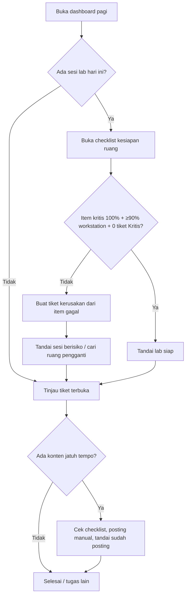
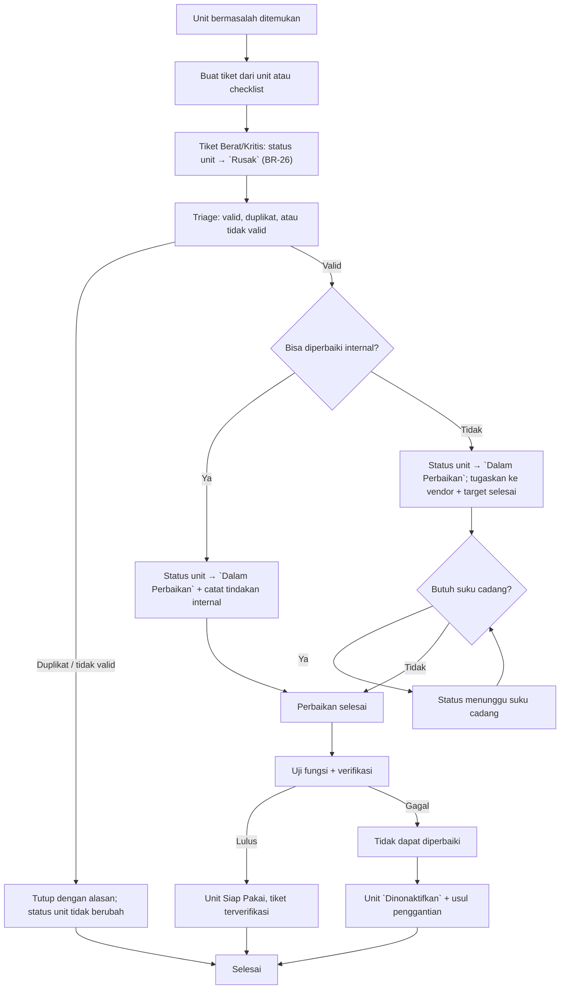
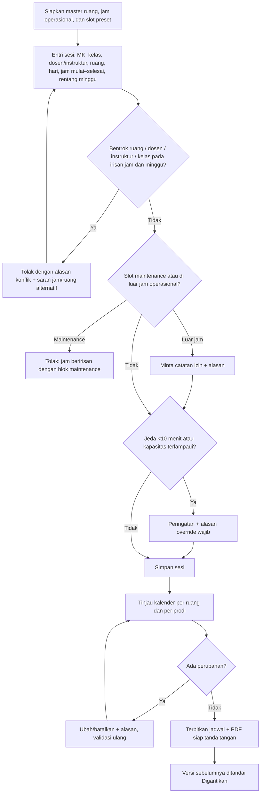
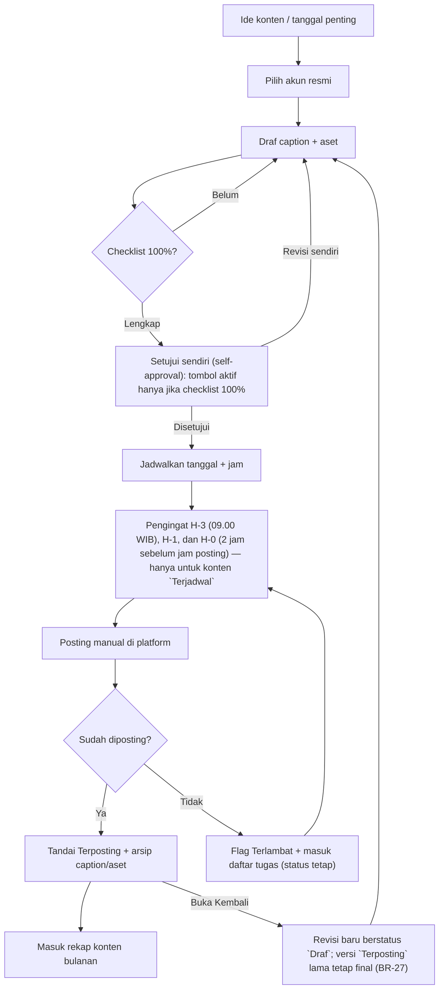
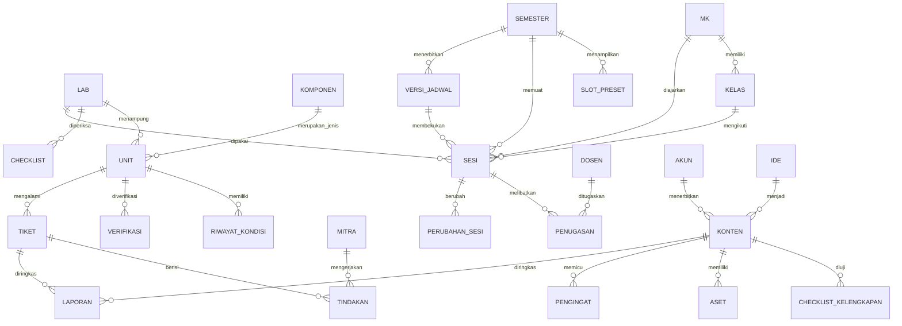

# PRD: LabOps ITG — Aplikasi Operasional Laboratorium Ilmu Komputer

> **Versi dokumen**: 1.2 (revisi pasca-review ronde 2)
> **Status**: Draf untuk review putaran 3
> **Pemilik produk**: Koordinator Laboratorium Jurusan Ilmu Komputer ITG
> **Penulis**: PRD Writer (otonom, atas dasar keputusan scope yang sudah dikonfirmasi pemilik produk)
> **Tanggal dibuat**: 2026-10-25
> **Terakhir diperbarui**: 2026-10-27

---

## 1. Informasi Dokumen

### 1.1 Informasi Dasar

| Atribut | Nilai |
|---------|-------|
| Nomor PRD | PRD-LAB-001 |
| Produk | LabOps ITG (aplikasi internal operasional laboratorium) |
| Jenis PRD | Fitur baru dengan UI (web responsif) |
| Prioritas | P0 (operasional inti unit kerja) |
| Versi yang direncanakan | v1.0 (MVP) |
| Pemilik keputusan | Koordinator Laboratorium Ilmu Komputer |
| Pengguna | 1 (satu) akun admin: Koordinator Laboratorium |
| Sumber konteks | `workflow/context-report.md` |

### 1.2 Riwayat Revisi

| Versi | Tanggal | Perubahan | Penulis |
|-------|---------|-----------|---------|
| 1.0 | 2026-10-25 | Draf lengkap: 5 modul MVP, aturan bisnis, metrik, acceptance criteria, roadmap | PRD Writer |
| 1.1 | 2026-10-25 | Revisi pasca-review: model waktu sesi (bukan slot), identitas dosen/MK/kelas, self-approval konten, aturan kesiapan, koreksi baseline bukti, AC NFR/BR, kontrak impor & cutover | PRD Fixer |
| 1.2 | 2026-10-27 | Revisi ronde 2: keterkaitan status unit–tiket, mesin status konten, pengingat H-3, bentrok vs jeda, kesiapan lab, M3, migrasi status konten, tambahan status lintas modul | PRD Fixer |
| 1.2 | 2026-10-27 | Revisi pasca-review ronde 2: keterkaitan status unit–tiket (BR-26), mesin status konten disederhanakan + revisi pasca-`Terposting` (BR-27), pengingat H-3 berbasis `Terjadwal`, pemisahan tegas bentrok vs jeda <10 menit, kriteria kesiapan lab satu sumber (BR-02), definisi waktu tiket M3/M4, migrasi konten deterministik, kode masalah `MS-n`, kode prioritas `PRI-n`, AC NFR/migrasi tambahan | PRD Fixer |

### 1.3 Glosarium

| Istilah | Definisi |
|---------|----------|
| **Komponen** | Jenis barang yang dikelola lab (contoh: PC workstation, monitor, proyektor, switch, AC, kabel, alat praktikum khusus). |
| **Unit** | Satu buah fisik dari sebuah komponen, dengan kode unik (contoh: `C201-PC-07`). |
| **Lab / Ruang** | Ruang fisik yang dijadwalkan dan diinventarisasi (contoh: C-I-01, C-II-01, D-II-02). |
| **Slot (preset)** | Pola jam yang ditampilkan sebagai pilihan cepat pada kalender (contoh: 08.00–10.50). Slot **bukan** satuan penyimpanan sesi dan boleh berbeda antar ruang, antar hari, dan antar semester. |
| **Sesi** | Satu catatan penggunaan lab yang berulang: hari, jam mulai, jam selesai, rentang minggu, ruang, dan penugasan dosen/instruktur/kelas. Satu sesi dapat menempati lebih dari satu slot preset. |
| **Kemunculan (occurrence)** | Satu kejadian nyata dari sebuah sesi pada satu minggu tertentu. Sesi berulang 16 minggu menghasilkan 16 kemunculan; yang disimpan tetap satu sesi. |
| **Rentang minggu** | Minggu ke-berapa sesi mulai dan berakhir dalam satu semester (contoh: minggu 1–16). Dua sesi hanya bentrok bila rentang minggunya beririsan. |
| **Bentrok** | Dua sesi atau lebih yang memiliki ruang, dosen, instruktur, atau kelas yang sama, **dan** rentang jam beririsan, **dan** rentang minggu beririsan. Jam yang bersambung tepat (selesai = mulai berikutnya) bukan bentrok. |
| **Kesiapan** | Hasil penilaian bahwa lab dapat dipakai untuk praktikum, memakai kriteria biner BR-02 (≥90% workstation `Siap Pakai` + 100% perangkat kritis lulus + tidak ada tiket Kritis terbuka + checklist ruang-hari dikonfirmasi). Skor checklist hanya informasi tambahan, bukan penentu. |
| **Status unit** | Satu status operasional eksklusif per unit (`Siap Pakai`, `Perlu Perhatian`, `Rusak`, `Dalam Perbaikan`, `Dinonaktifkan`, `Hilang`) sesuai 7.1. Tidak ada field "kondisi" terpisah di samping status ini. |
| **Perlu Verifikasi** | Penanda (badge) bahwa unit belum diverifikasi ulang dalam 90 hari. Penanda ini **tidak** mengubah status unit dan tidak otomatis membuat lab tidak siap. |
| **Belum Terverifikasi** | Penanda untuk unit yang baru dibuat dan belum pernah punya catatan verifikasi (tanggal verifikasi terakhir kosong). Perlakuan tugasnya sama dengan `Perlu Verifikasi`, tetapi status unit tetap apa adanya. |
| **Kapasitas terlampaui** | Flag turunan pada sesi yang **sudah tersimpan**: kapasitas ruang saat ini (jumlah unit workstation `Siap Pakai`) lebih kecil daripada jumlah mahasiswa sesi. Sesi tidak dibatalkan otomatis; flag tampil di dashboard dan daftar tugas. |
| **Tiket** | Catatan kerusakan satu atau beberapa unit, dengan siklus status dan riwayat tindakan. |
| **Konten** | Satu rencana unggahan media sosial untuk satu akun resmi pada satu tanggal. |
| **Akun Media Sosial Resmi** | Empat akun resmi yang dikelola: **Akun Fakultas** (Fakultas Ilmu Komputer) dan **tiga Akun Prodi** (Teknik Informatika, Sistem Informasi, Pascasarjana Ilmu Komputer). Istilah "akun prodi" saja tidak mencakup akun fakultas. |
| **Persetujuan mandiri (self-approval)** | Tindakan koordinator menyatakan kontennya sendiri layak tayang setelah checklist 100%. Bukan alur persetujuan dua orang; tidak ada approver kedua di MVP. |
| **Terbit** | Snapshot jadwal yang dinyatakan resmi pada satu waktu. Perubahan setelah terbit menghasilkan versi baru; versi lama berstatus **Digantikan**. |
| **Digantikan** | Status versi jadwal lama yang sudah tidak resmi tetapi tetap dapat dibuka untuk audit. |
| **Terposting** | Status konten yang sudah diunggah manual dan dikonfirmasi koordinator. Padanan status lama `Terupload`. Bersifat final: koreksi hanya berupa catatan; perubahan isi dilakukan dengan membuat **revisi baru** (BR-27). |
| **Revisi konten** | Salinan kerja baru dari konten `Terposting` yang dibuka kembali, dengan nomor revisi bertambah dan tautan ke versi asli. Revisi mulai dari `Draf`; versi asli tetap `Terposting` dan dapat diaudit. |
| **Kode prioritas tiket (`PRI-n`)** | Singkatan `PRI-1`…`PRI-4` pada 7.3, dipakai untuk menghindari tabrakan dengan kode masalah `MS-n` dan prioritas dokumen `P0`. |
| **Terlambat** | **Flag turunan**, bukan status tersimpan: `sekarang > tanggal+jam jadwal + toleransi` dan status bukan `Terposting`/`Dibatalkan`/`Ditunda`. Toleransi = akhir hari (23.59 WIB). |
| **Break-glass** | Prosedur penggunaan akun darurat tersegel oleh pihak berwenang, dengan alasan tercatat, notifikasi, dan reset kata sandi setelah dipakai. |

---

## 2. Latar Belakang dan Tujuan

### 2.1 Latar Belakang

Koordinator Laboratorium Jurusan Ilmu Komputer mengelola **6 ruang lab** (C-I-01, C-I-02, C-II-01, C-II-02, D-II-01, D-II-02) dengan **74 baris jadwal per minggu** pada TA 2025/2026 Ganjil — **70 sesi pengajaran + 4 blok maintenance** — tersebar pada **31 kombinasi ruang-hari**. Ditambah **4 akun media sosial resmi** (1 akun fakultas + 3 akun prodi), administrasi praktikum (**28 berita acara per kelas + 1 form gabungan + 1 instrumen kerja** pada 2023 Genap), dan kegiatan penunjang seperti pelatihan ITS (239 file administrasi).

Seluruh pekerjaan tersebut saat ini dijalankan dengan **spreadsheet, PDF, dan folder gambar**. Pemindaian workspace pada 2026-10-25 (**4.573 file saat pemindaian**) tidak menemukan aplikasi, basis data, atau daftar inventaris sama sekali. Akibatnya, satu orang menanggung beban operasional, administrasi, dan dokumentasi tanpa satu pun sumber data tunggal.

### 2.2 Masalah

> Kode masalah memakai awalan `MS-` (mis. `MS-1`) agar tidak bertabrakan dengan kode prioritas tiket `PRI-1`…`PRI-4` (7.3) dan prioritas dokumen `P0` (1.1).

| Kode | Masalah | Bukti | Dampak |
|------|---------|-------|--------|
| MS-1 | Tidak ada daftar inventaris dan kondisi komponen | Pemindaian keyword `invent/asset/aset/stok/komponen/rusak/perbaikan` pada 4.573 file → 0 file inventaris | Tidak bisa menjawab "berapa PC siap pakai di C201 Senin pagi" tanpa cek fisik; pengadaan dan klaim garansi tanpa dasar |
| MS-2 | Riwayat kerusakan tidak terstruktur | Hanya catatan naratif di TXT rapat dan berita acara; tidak ada kolom kondisi/biaya/tanggal selesai | Perbaikan berulang tidak terdeteksi; tidak ada MTTR; keputusan ganti vs perbaiki tanpa data |
| MS-3 | Jadwal tersebar dan berversi ganda | 6 varian `Ploting Pengajaran ILKOM 2025-2026 Ganjil`; 22 file mengandung `Copy`; versi ditandai `REV 1/2/3`, `student day v2/v3/v4` | Risiko memakai versi salah; perubahan tidak terlacak; jadwal resmi sulit dipastikan |
| MS-4 | Bentrok jadwal diselesaikan manual | Catatan rapat: *"tidak bisa, karena bentrok dengan jadwal teori grafkom bu sri"*, *"tidak bisa, jadwal lab sabtu enuh"* | Negosiasi berulang per dosen; potensi bentrok lolos ke jadwal terbit |
| MS-5 | Identitas ruang berubah antar tahun | `Labkom 1/2, STI, Jaringan, MM` (2021/2022) → `C-I-01…D-II-02` (2025/2026) → `C-II-LAB1` (berita acara 2023); bukti: `Jadwal\jadwal lab ilkom 2021-2.xlsx`, `jadwal penggunaan lab 2025-2026 ganjil.xlsx`, `Jadwal\2023 GENAP\Berita Acara Praktikum\Praktikum Basis Data A.pdf` | Salah ruang saat penjadwalan dan pencarian arsip |
| MS-6 | Konten medsos tidak terlacak | Kalender konten **185 baris data = 174 item unik** (11 baris duplikat Desember 2021): 149 `Menunggu Konfirmasi`, 16 `Di Jadwalkan`, 9 `Di Terima`; **hanya 2 `Terupload`** (di kolom `Keterangan`, bukan `Status`); 15 item belum bertanggal; satu kalender untuk 4 akun; status ganda (`Status` vs `Keterangan`) | Konten terlewat, tidak ada kejelasan status, tidak ada bukti unggah |
| MS-7 | Arsip aset tidak terindeks | **829 file di 42 folder non-root** tanpa metadata; nama folder `Juli 20206`, `September`, `New folder`; `Dokumen Online\Template\` hanya **34 PSD** (20 root + 14 di `2021`), bukan 92 | Aset tidak bisa ditemukan ulang; duplikasi pembuatan desain |
| MS-8 | Pelaporan dan administrasi manual | 2023 Genap: **28 berita acara per kelas (masing-masing 3 halaman) + 1 form gabungan 81 halaman + 1 instrumen kerja 174 halaman**; rekap ITS 239 file | Akhir bulan/semester menjadi beban puncak; laporan lambat |

### 2.3 Tujuan Produk

| Kode | Tujuan | Indikator tercapai |
|------|--------|--------------------|
| G1 | Satu sumber kebenaran untuk status dan kesiapan lab | Setiap unit punya kode, status, dan riwayat; status kesiapan per lab tampil pada layar pertama dashboard; waktu penyelesaian checklist diukur M1 (bukan waktu melihat) |
| G2 | Siklus kerusakan–perbaikan terlacak ujung ke ujung | Setiap kerusakan punya tiket, status, biaya (bila ada tindakan), dan catatan verifikasi; kepatuhan remediasi + verifikasi diukur M4, kelengkapan field diuji di 10.2 |
| G3 | Jadwal terbit bebas bentrok | 0 bentrok ruang/dosen/kelas pada jadwal yang dinyatakan terbit |
| G4 | Konten 4 akun resmi terencana dan tidak terlewat | ≥90% konten terjadwal terposting pada tanggalnya dan terarsip lengkap |
| G5 | Pelaporan bulanan dan semesteran cepat | Laporan bulanan tersedia ≤15 menit tanpa rekap manual |

### 2.4 Metrik Keberhasilan

> Belum ada data historis untuk sebagian besar metrik. Karena itu baseline ditetapkan sebagai **cara pengukuran yang harus diambil pada 2 minggu pertama setelah rilis** (atau sebelum rilis untuk metrik yang bisa diukur manual).

| Kode | Metrik | Baseline | Target | Sumber data | Rumus / cara ukur |
|------|--------|----------|--------|-------------|-------------------|
| M1 | Waktu menyelesaikan checklist kesiapan 1 ruang pada 1 hari pakai | Belum terukur; ukur dengan stopwatch pada 5 ruang-hari pertama | Median ≤5 menit/ruang-hari | Timestamp buka checklist → simpan | Median 5 sampel; ruang-hari = kombinasi ruang + tanggal yang punya sesi (31/minggu pada jadwal 2025/2026) |
| M2 | % unit tercatat lengkap (kode, lokasi, status unit) | 0% (tidak ada file inventaris) | 2 lab prioritas 100% dalam 30 hari setelah Go-Live; 6 lab 100% dalam 6 bulan | Jumlah unit di sistem vs hasil stock opname | Unit lengkap ÷ unit hasil opname × 100%; rekonsiliasi bulanan |
| M3 | Kepatuhan respons awal terhadap target prioritas | Belum ada tiket | ≥90% per bulan untuk setiap prioritas | Timestamp `Dilaporkan` → `Ditriase` | Respons awal = transisi `Dilaporkan → Ditriase`. Patuh bila durasi ≤ target 7.3 untuk prioritas tiket: PRI-1/PRI-2 ≤1, PRI-3 ≤2, PRI-4 ≤3 hari kerja. Tiket patuh ÷ tiket baru × 100%, dilaporkan per prioritas |
| M4 | Kepatuhan remediasi dan verifikasi | Tidak ada data; ukur retrospektif 10 tiket pertama | ≥90% tiket `Selesai Diperbaiki` dalam SLA keparahan; median `Selesai Diperbaiki` → `Terverifikasi` ≤1 hari kerja | Riwayat status tiket | Remediasi = `Dilaporkan` → `Selesai Diperbaiki`, SLA mengikuti BR-06 (Ringan 7, Sedang 14, Berat termasuk vendor 30, Kritis 3 hari). Verifikasi diukur terpisah (`Selesai Diperbaiki` → `Terverifikasi`). Angka BR-06 **tidak** dipakai untuk rentang `Dilaporkan` → `Terverifikasi` |
| M5 | Jumlah bentrok pada jadwal terbit | Belum tersedia; audit manual 74 baris jadwal 2025/2026 dengan definisi BR-08 tidak menemukan bentrok. 9 pasangan berjeda 0 menit dan 1 berjeda 10 menit adalah variasi jam/jeda (BR-09), bukan pelanggaran, dan tidak dipakai sebagai proksi bentrok | 0 bentrok ruang/dosen/instruktur/kelas | Log validasi + riwayat perubahan sesi | Hitung pasangan sesi yang memenuhi BR-08 pada setiap versi terbit; jumlah file `Copy` **tidak** dipakai sebagai proksi |
| M6 | Ketepatan posting konten | **2 dari 174 item unik (1,1%)** ber-`Keterangan = Terupload`; jika hanya item bertanggal: 2/159 (1,3%) | ≥90% konten terjadwal terposting pada tanggalnya | Status `Terposting` + waktu konfirmasi | Konten jatuh tempo yang `Terposting` **pada atau sebelum 23.59 WIB tanggal jadwal** ÷ konten yang jatuh tempo × 100%, per akun per bulan. Posting lebih awal dihitung tepat waktu; posting setelah akhir tanggal dihitung terlambat (flag `Terlambat`) |
| M7 | Waktu menyusun laporan bulanan | Belum terukur; ukur manual saat menyusun laporan Oktober 2026 | ≤15 menit | Durasi sesi ekspor laporan | Time-on-task 3 bulan berturut-turut |
| M8 | Kelengkapan arsip konten baru | 0 dari 829 file lama punya caption/metadata; **tidak dihitung** dalam M8 | 100% konten baru yang `Terposting` punya caption + aset tertaut | Relasi konten → aset | Konten baru pasca-Go-Live dengan caption+aset ÷ konten baru `Terposting` × 100%; sampling 20/bulan |
| M9 | Konsistensi laporan penggunaan lab dengan jadwal terbit (rekonsiliasi internal) | Manual dari 74 baris/minggu (70 sesi + 4 maintenance); rawan tidak sinkron | 100% sama dengan jadwal terbit | Laporan vs jadwal | Bandingkan jumlah kemunculan dan jam per ruang/minggu; rekonsiliasi per semester. Metrik ini menguji konsistensi internal, bukan kehadiran nyata; akurasi kehadiran memerlukan data absensi dan berada di luar MVP |

> Angka 74 baris, 31 ruang-hari, 174 item, dan 2 `Terupload` di atas adalah hasil hitung ulang langsung dari file sumber (metode di 2.7 dan 13.1). Angka yang belum dapat diukur tetap ditulis "belum tersedia" beserta cara mengukurnya; tidak ada baseline yang dikarang.

### 2.5 Kondisi Saat Ini dan Perubahan

#### 2.5.1 Proses Saat Ini (berbasis bukti file)

| Area | Cara kerja sekarang | Alat | Bukti |
|------|---------------------|------|-------|
| Inventaris | Tidak ada pencatatan; kondisi diketahui dari pengecekan fisik dan ingatan | — | Pemindaian 0 file inventaris |
| Kerusakan | Dilaporkan lisan/chat; perbaikan dicatat di catatan rapat atau tidak sama sekali | TXT, WhatsApp, berita acara | `Jadwal\2024 GANJIL\Penjadwalan\rapat 10-08-2024.txt` |
| Penjadwalan | Satu file Excel per ruang; jadwal praktikum disusun ulang menjadi PDF; revisi disimpan sebagai salinan file | Excel + PDF | `jadwal penggunaan lab 2025-2026 ganjil.xlsx` (6 sheet); 6 varian file ploting |
| Maintenance | Ditulis sebagai baris "Maintenance dan Pengecekan Fasilitas" di dalam jadwal mengajar | Excel | 4 blok maintenance pada file 2025/2026 Ganjil |
| Media sosial | Satu kalender konten untuk semua akun; status dicatat di dua kolom terpisah; aset disimpan di folder bulan | Excel + folder file | `kalender konten media jurusan ilmu komputer.xlsx`; `Dokumen Online\IG Post\` |
| Pelaporan | Rekap manual dari berita acara dan jadwal; disusun saat diminta | Excel + PDF | 28 berita acara per kelas + 1 form gabungan + 1 instrumen kerja (2023 Genap) |

#### 2.5.2 Perubahan yang Diharapkan

| Perubahan | Sebelum | Sesudah |
|-----------|---------|---------|
| Cek kesiapan | Cek fisik + ingatan | Checklist + skor kesiapan + daftar penghambat |
| Lapor kerusakan | Chat/lisan | Tiket dengan status, tenggat, biaya, dan verifikasi |
| Menyusun jadwal | Salin Excel, cek bentrok manual | Entri sesi dengan validasi otomatis + jadwal terbit berversi |
| Konten medsos | Kalender tunggal, status tidak baku | Kalender per akun, siklus status, pengingat, arsip caption/aset |
| Laporan | Rekap manual | Laporan satu klik + dashboard harian |

#### 2.5.3 Dampak dan Batasan Pengguna Tunggal

Aplikasi dirancang untuk **satu pengguna admin** (Koordinator Lab). Konsekuensi yang harus disadari:

- **Single point of failure tanpa delegasi**: cuti, sakit, atau mutasi membuat operasional berhenti, dan asisten lab/dosen tidak dapat melaporkan kerusakan langsung; laporan masuk melalui koordinator. Mitigasi: prosedur **break-glass** dan SOP kontinuitas di R1, bukan akun bersama tanpa jejak.
- **Tidak ada pemisahan tugas**: orang yang menyiapkan konten juga yang menyetujui. Karena itu MVP memakai **gate checklist + persetujuan mandiri** (BR-15/BR-15a), bukan alur persetujuan dua orang. Tidak ada status antrean persetujuan terpisah: `Draf` langsung menjadi `Disetujui` saat checklist 100% dan koordinator menekan "Setujui".
- **Tidak ada jejak persetujuan pihak lain**: laporan resmi tetap memerlukan tanda tangan di luar aplikasi sampai Fase 3. Jika Kaprodi kelak harus menyetujui konten, itu perubahan scope Fase 2 (bukan MVP).

### 2.6 Identifikasi Kapabilitas Terkait

| Kapabilitas yang ada | Cakupan | Kesesuaian | Kesenjangan | Arah | Sumber |
|----------------------|---------|------------|-------------|------|--------|
| Kalender konten medsos (Excel) | 185 baris data / 174 item unik, 12 bulan, status + target | Sebagian | Tanpa 4 akun terpisah, tanpa siklus status baku, tanpa pengingat/arsip, 15 item tanpa tanggal | Ganti; migrasi data awal | `Dokumen Online\kalender konten media jurusan ilmu komputer.xlsx` |
| Jadwal lab per ruang (Excel/PDF) | 6 ruang, 74 baris/minggu (70 sesi + 4 maintenance), 31 ruang-hari | Sebagian | Validasi manual, tanpa versi, nama ruang berubah, jam berbeda per ruang/hari | Ganti dengan penjadwalan tervalidasi | `Jadwal\2025-2026 GANJIL\5 Jadwal penggunaan ruangan\jadwal penggunaan lab 2025-2026 ganjil.xlsx` |
| Jadwal praktikum per kelas (PDF) | MK, kelas, dosen, hari, jam, ruang | Sebagian | Diturunkan manual, rawan tidak sinkron | Jadikan keluaran otomatis | `Jadwal\2025-2026 GANJIL\4 Jadwal Praktikum ILKOM\Jadwal Praktikum Jurusan ILKOM Semester Ganjil T.A 2025 - 2026.pdf` |
| Berita acara praktikum | Bukti pelaksanaan bertanda tangan | Tidak sesuai MVP | Dokumen resmi, tidak terhubung data | Di luar MVP | `Jadwal\2023 GENAP\Berita Acara Praktikum\Praktikum Basis Data A.pdf` |
| Arsip aset desain & template | 34 template PSD di `Template` + 829 file arsip | Sebagian | Tanpa metadata, tidak dapat dicari; 92 PSD adalah total seluruh workspace (47 ID card ITS, 5 sertifikat, 4 IG Post, 2 ITS lain, 34 Template) | Modul arsip konten | `Dokumen Online\Template\`; `Dokumen Online\IG Post\` |
| Inventaris & kondisi komponen | — | Tidak ada | Tidak ada daftar maupun riwayat | Bangun baru | Pemindaian keyword (lihat laporan konteks) |
| Log kerusakan & perbaikan | — | Tidak ada | Tanpa tiket/biaya/MTTR | Bangun baru | Pemindaian keyword (lihat laporan konteks) |
| Sistem/aplikasi laboratorium | — | Tidak ada | Tanpa kode/DB/API | Bangun baru | Pemindaian `README`, `package.json`, `*.sql`, `openapi*` → 0 hasil |

Rincian metode pemindaian, file yang berhasil/tidak berhasil dibaca, dan angka pendukung ada di `workflow/context-report.md`.

### 2.7 Tabel Konsistensi Angka

> Satu angka dipakai dengan definisi yang sama di seluruh dokumen. Jika sebuah angka berubah, tabel ini yang diperbarui lebih dulu, lalu section yang merujuk.

| Angka | Nilai terverifikasi | Definisi / metode hitung | Dipakai di |
|-------|---------------------|--------------------------|------------|
| Ruang lab | 6 | Sheet `C101`–`D202` pada file jadwal 2025/2026 | 2.1, 4.2, NFR-14, A1 |
| Baris jadwal per minggu | 74 = **70 sesi pengajaran + 4 maintenance** | Baris ber-hari pada 6 sheet; maintenance dikenali dari teks "Maintenance…" di kolom kode/MK | 2.1, 2.2, 6.3, 7, M9, NFR-14 |
| Ruang-hari | **31 per minggu** | Kombinasi unik ruang + hari yang punya sesi pengajaran | M1, BR-02 |
| Bentuk jam | ≥12 pola jam berbeda; 9 pasangan berjeda 0 menit; 1 pasangan berjeda 10 menit; 1 sel jam salah tulis (`14.40.17.30`) | Parse `jam` tiap baris; interval [mulai, selesai); hitung selisih | 5.2, 6.3, BR-08/09, 10.3 (impor 74 baris) |
| Ambang kesiapan lab | ≥90% workstation `Siap Pakai` + 100% perangkat pengajaran kritis lulus + 0 tiket Kritis terbuka + checklist ruang-hari dikonfirmasi | BR-02; skor checklist tidak dipakai sebagai penentu | 4.3, 6.1, BR-02, 10.1 |
| Unit inventaris | 150–240 unit inti (asumsi 25–40/lab); kapasitas desain 300 termasuk periferal | A1 × 6 lab; belum ada file inventaris untuk verifikasi | A1, NFR-14 |
| Baris kalender konten | 185 baris data = **174 item unik**; 159 bertanggal; 15 tanpa tanggal; 11 duplikat | Baris 6–238; buang 12 judul bulan, 12 baris header, 24 baris kosong; dedup `judul+tanggal` | 2.1, 2.2, M6, BR-16, M0, 6.7 |
| Konten terupload | 2 dari 174 (1,1%) | Kolom `Keterangan = Terupload`; bukan kolom `Status` | M6, 6.4 |
| Status konten unik | 149 Menunggu Konfirmasi; 16 Di Jadwalkan; 9 Di Terima | Setelah dedup 11 baris | 2.2, 6.7 |
| Status konten setelah migrasi | 15 `Ide`, 155 `Draf`, 2 `Terposting`, 2 `Dibatalkan`, 0 `Terjadwal`, 0 `Disetujui` | Pemetaan deterministik 6.7.2 (default tanpa checklist migrasi) | 6.7.2, 10.7, M0 |
| Arsip IG | 829 file di 42 subfolder non-root (40 subfolder berisi file) | Hitung rekursif `IG Post`; root berisi 4 file | 2.2, 2.6, M8 |
| Template PSD | **34** di `Template` (20 root + 14 `2021`); **92** total workspace | Hitung ekstensi `.psd` per folder | 2.2, 2.6, 13.1 |
| Berita acara 2023 Genap | 28 per kelas (3 hlm) + 1 form gabungan (81 hlm) + 1 IK (174 hlm) | Hitung PDF + halaman | 2.1, 2.2, 13.1 |
| File administrasi ITS | 239 | Rekursif folder `ITS` | 2.1, 2.2 |
| Duplikasi file kerja | 22 file `Copy` pada snapshot 2026-10-25; **23 file `Copy` saat audit 2026-10-27** (21 di `Jadwal`, 2 di luar `Jadwal`); 6 varian ploting | Hitung nama file berisi `Copy`; snapshot dan audit dihitung terpisah | 2.2 (bukan M5) |
| Snapshot workspace | 4.573 file (pemindaian 2026-10-25) | Pemindaian rekursif; dokumen kerja yang dibuat setelah pemindaian tidak dihitung dalam baseline | 2.1, 13.1 |

---

## 3. Ruang Lingkup

### 3.1 Termasuk dalam Lingkup (MVP)

1. **Inventaris & kesiapan komponen**: katalog komponen dan unit, kondisi, lokasi, riwayat, checklist kesiapan lab, stok habis pakai.
2. **Kerusakan & perbaikan**: tiket, triase, tindakan internal/vendor, biaya, verifikasi akhir, SLA internal.
3. **Penjadwalan penggunaan lab**: master ruang, slot preset semester, entri sesi, validasi bentrok, maintenance block, kalender dan cetak jadwal.
4. **Media sosial 4 akun resmi**: ide konten, kalender per akun, checklist + persetujuan mandiri, pengingat posting, arsip caption/aset, rekap konten.
5. **Pelaporan & dashboard**: dashboard harian, 5 laporan inti, laporan bulanan satu klik, ekspor.
6. **Fondasi lintas modul**: login admin tunggal, pencarian global, notifikasi dalam aplikasi + email, log aktivitas, pengaturan master data, cadangan, serta kontrak impor/migrasi dan cutover dari Excel.

### 3.2 Di Luar Lingkup

| Di luar lingkup | Alasan / rencana |
|-----------------|------------------|
| Multi-pengguna, multi-peran, delegasi | Keputusan scope; dipertimbangkan Fase 2 (R1) |
| Pengajuan pemakaian lab mandiri oleh dosen + alur approval | MVP hanya input oleh koordinator |
| Auto-publish ke media sosial dan penarikan metrik via API | Posting manual di MVP; Fase 3 |
| Penerbitan berita acara resmi dan sertifikat praktikum/ITS | Dokumen bertanda tangan; kandidat Fase 3 |
| Administrasi prodi dan keuangan kampus (rekrutmen instruktur, jadwal kuliah teori, e-learning, pengadaan, anggaran, akuntansi aset) | Bukan operasional lab atau di luar kewenangan koordinator |
| Integrasi SIAKAD/SSO kampus | Tidak ada bukti ketersediaan; asumsi A9 |
| Aplikasi mobile native, RFID/barcode, monitoring IoT alat | Tidak diperlukan untuk MVP |

### 3.3 Hal yang Masih Perlu Dikonfirmasi

Keputusan scope sudah dikunci (satu pengguna, web responsif, 5 modul, posting manual, input jadwal manual). Yang belum diputuskan dan **dapat mengubah cakupan data atau penerimaan** dikumpulkan di 12.4; ringkasannya:

- [ ] **Q1 — hosting/domain/email institusi**: menentukan kelayakan rilis daring dan pengingat email.
- [ ] **Q3 — format resmi laporan jurusan**: menentukan tata letak laporan bulanan.
- [ ] **Q4 — apakah jadwal kuliah teori (non-lab) ikut dikelola**: menentukan volume sesi dan master data.
- [ ] **Q5 — jumlah unit nyata per lab**: menentukan target M2 dan cakupan stock opname.
- [ ] **Q6 — izin menyimpan NIDN**: menentukan batas data minimal (NFR-13).
- [ ] **Q7 — penanda tangan PDF jadwal/laporan**: menentukan alur pengesahan di luar aplikasi.
- [ ] **Q9 — anggaran operasional**: menentukan kelayakan biaya hosting.

Butir di luar daftar ini dianggap sudah diputuskan dan tidak membuka kembali scope MVP.

---

## 4. Pengguna dan Perjalanan Pengguna

### 4.1 Persona

**Persona utama — "Koordinator Lab" (satu-satunya pengguna aplikasi)**

| Aspek | Deskripsi |
|-------|-----------|
| Peran | Koordinator Laboratorium Jurusan Ilmu Komputer |
| Tanggung jawab | Kesiapan alat, pencatatan kerusakan/perbaikan, penjadwalan lab, 4 akun medsos prodi, pelaporan |
| Konteks kerja | Berpindah antara ruang lab, ruang jurusan, dan rapat; sering di lapangan |
| Perangkat | Laptop di ruang kerja; HP saat berkeliling lab |
| Kemampuan teknis | Terbiasa Excel dan PDF; bukan pengembang |
| Kebutuhan utama | Cepat dipakai, tidak menambah pekerjaan administratif, bisa diakses dari HP |

**Penerima manfaat tanpa akun** (tidak login, hanya menerima keluaran): dosen/instruktur/asisten (jadwal dan status ruang), ketua prodi (laporan), mahasiswa (informasi jadwal yang ditempel/dibagikan), vendor (permintaan perbaikan di luar aplikasi).

### 4.2 Prasyarat

| Prasyarat | Keterangan |
|-----------|------------|
| Master data awal | 6 ruang, daftar prodi, daftar mitra/vendor, slot preset semester aktif |
| Data inventaris awal | Hasil stock opname minimal 2 lab prioritas sebelum Go-Live |
| Akun pengguna | Satu akun admin aktif + email pemulihan |
| Jadwal semester aktif | Dimasukkan sebelum masa penyusunan jadwal berakhir |
| Kebijakan | Pimpinan menetapkan bahwa jadwal dari sistem adalah acuan resmi |
| Jaringan | Koneksi internet di ruang lab dan ruang kerja |

### 4.3 Perjalanan Harian

> Keputusan siap/tidak siap memakai kriteria biner BR-02 (lihat 7.4 dan 2.7), bukan "semua item lulus". Item opsional yang gagal tidak menghambat kesiapan, tetapi tetap tercatat sebagai penghambat di daftar periksa.

### 4.4 Skenario Kunci

| Skenario | Pemicu | Langkah utama | Hasil yang diharapkan | Modul |
|----------|--------|---------------|-----------------------|-------|
| **Hari biasa** | Pagi sebelum praktikum | Cek dashboard → checklist ruang → tangani tiket → konfirmasi konten | Tidak ada kejutan saat kelas masuk | Semua |
| **Sebelum semester** | 2–4 minggu sebelum semester | Perbarui master ruang, jam operasional, dan slot preset → masukkan sesi (hari, jam mulai–selesai, rentang minggu) → validasi bentrok → terbitkan PDF → siapkan checklist awal | Jadwal terbit bebas bentrok, PDF siap tanda tangan | SCH, INV |
| **Saat alat rusak** | Dosen/asisten melaporkan PC mati | Cari unit → buat tiket → triase → tindakan/vendor → verifikasi → unit kembali siap | Riwayat lengkap, sesi terdampak diketahui, MTTR terukur | INV, RPR, SCH |
| **Saat praktikum bentrok** | Dua kelas meminta jam/ruang sama | Entri sesi → sistem menolak dengan alasan konflik (ruang/dosen/kelas + irisan jam/minggu) → cari jam/ruang alternatif → simpan | 0 bentrok terbit, alasan perubahan tercatat | SCH |
| **Saat konten menumpuk** | 4 akun butuh konten bulan depan | Ide → draf → checklist → setujui sendiri → jadwalkan → pengingat H-3/H-1/H-0 → posting manual → tandai terposting | Tidak ada konten terlewat, arsip lengkap | SOS |
| **Akhir bulan lapor** | Diminta laporan bulanan | Buka laporan bulanan → pilih periode → ekspor PDF → arsipkan | Laporan ≤15 menit, angka konsisten dengan data harian | RPT |

### 4.5 Alur Alternatif dan Gagal

| Kondisi | Perilaku yang diharapkan |
|---------|--------------------------|
| Unit yang dilaporkan tidak ada di inventaris | Pengguna dapat membuat unit baru sambil melaporkan; unit diberi flag `Belum Terverifikasi` (1.3), bukan status baru |
| Unit diubah ke `Dalam Perbaikan` tanpa tiket aktif | Penyimpanan ditolak; sistem menawarkan dua jalan: buka tiket untuk unit itu, atau simpan sebagai `Rusak` tanpa perbaikan berjalan (BR-26) |
| Tiket Berat/Kritis dibuka untuk unit `Siap Pakai` | Status unit berpindah ke `Rusak` dengan alasan otomatis; unit tidak dapat disimpan sebagai `Siap Pakai` selama tiket itu terbuka (BR-26) |
| Tiket duplikat untuk unit yang sama | Triase menandai duplikat dan menutup tanpa verifikasi, dengan alasan wajib |
| Perbaikan gagal / unit mati | Tiket ditutup sebagai "Tidak Dapat Diperbaiki" + usul penggantian; unit menjadi `Dinonaktifkan` |
| Vendor melewati tenggat | Status tetap `Menunggu Suku Cadang/Vendor`; tiket muncul di daftar terlambat dan waktu tunggu vendor tetap dihitung dalam SLA remediasi (BR-06), tiket tidak menutup otomatis |
| Jadwal berubah setelah terbit | Wajib alasan; versi lama disimpan; dokumen terbit ditandai "digantikan" |
| Kapasitas ruang turun setelah sesi tersimpan | Sesi diberi flag `Kapasitas terlampaui` (1.3) di dashboard dan daftar tugas; sesi tidak dibatalkan otomatis (BR-23) |
| Konten batal tayang | Status "Dibatalkan" + alasan; konten turunan tetap berjalan sendiri |
| Konten lewat jadwal tanpa konfirmasi | Status tidak berubah; flag `Terlambat` muncul otomatis, masuk daftar tugas, dan hilang saat `Terposting`/`Dibatalkan` |
| Konten `Terposting` dibuka kembali | Dibuat **revisi baru** berstatus `Draf` dengan nomor revisi bertambah; versi `Terposting` lama tetap final dan dapat diaudit (BR-27) |
| Sesi dengan **irisan jam/minggu** saat impor (bentrok) | Baris **ditolak** dan dilaporkan dengan nomor baris sumber; tidak ada override. Baris lain dalam batch tetap dapat diproses (BR-08, NFR-12) |
| Sesi **bersambung tepat** (jeda 0 menit) atau jeda <10 menit saat impor | Bukan bentrok. Baris disimpan dengan peringatan + alasan "data historis" (BR-09) |
| Unit diverifikasi >90 hari lalu | Muncul badge `Perlu Verifikasi` dan tugas pengecekan; status unit tidak berubah otomatis |

---

## 5. Alur Utama

### 5.1 Pelaporan Kerusakan → Perbaikan → Verifikasi

### 5.2 Penjadwalan Penggunaan Lab

> Slot preset hanya membantu pengisian cepat; yang disimpan adalah jam mulai dan jam selesai. Karena itu sesi C102 Rabu 10.30–13.00 dan 13.00–15.30 dapat hidup berdampingan (jeda 0 menit) dengan peringatan, bukan error.

### 5.3 Konten Media Sosial

> Tidak ada langkah "ajukan ke atasan" dan tidak ada status antrean persetujuan di MVP. Persetujuan dicatat sebagai tindakan koordinator sendiri beserta waktu dan identitas; jika Kaprodi harus menyetujui, itu perubahan scope Fase 2.
>
> Pengingat berbasis tanggal hanya berlaku untuk konten yang **sudah punya tanggal**, yaitu `Terjadwal`. Konten `Draf`/`Ide` tanpa tanggal tidak menerima pengingat H-3; konten seperti itu muncul di daftar "konten tanpa tanggal" pada dashboard.

---

## 6. Kebutuhan Fungsional

> Prioritas memakai MoSCoW: **M** = Must, **S** = Should, **C** = Could, **W** = Won't (fase ini).
> Semua FR berprioritas M/S/C pada tabel di bawah termasuk MVP kecuali ditandai fase lain.

### 6.1 Modul Inventaris dan Kesiapan Komponen

**Deskripsi**: mencatat seluruh komponen lab sebagai unit ber-kode, memantau status dan lokasi, serta menentukan kesiapan lab sebelum praktikum.

**Tata letak**: pola daftar–filter–detail. Baris atas: pencarian kode/unit + filter lab, kategori, status; kartu ringkasan jumlah unit per status; tabel unit (kode, komponen, lab, status, badge verifikasi, aksi); tombol tambah unit, impor, cetak daftar unit. Tombol label/QR belum ada di MVP (Fase 2).

| ID | Kebutuhan | Prioritas |
|----|-----------|-----------|
| FR-INV-01 | Katalog komponen (jenis) dan unit fisik dengan kode unik yang dapat dibaca manusia | M |
| FR-INV-02 | Atribut unit: kategori, merek/model, nomor seri, lab, titik penempatan, tanggal perolehan, sumber dana, masa garansi, status kepemilikan | M |
| FR-INV-03 | Pemetaan unit ke lab dan titik penempatan, termasuk perangkat pendukung ruang (proyektor, AC, switch, kabel) | M |
| FR-INV-04 | Pencatatan **status unit** dengan enam status baku 7.1 dan alasan perubahan; perpindahan status yang dipicu tiket mengikuti BR-26 | M |
| FR-INV-05 | Riwayat status unit, mutasi lokasi, dan penanggung jawab tiap unit | M |
| FR-INV-06 | Checklist kesiapan lab pra-praktikum **per ruang + tanggal** (bukan per sesi); satu checklist berlaku untuk semua sesi di ruang itu pada tanggal tersebut, dengan item wajib dan item opsional | M |
| FR-INV-07 | Status siap/tidak siap lab dihitung dengan kriteria biner BR-02 (≥90% workstation `Siap Pakai` + 100% item kritis lulus + tidak ada tiket Kritis terbuka + checklist dikonfirmasi) beserta daftar penghambat; skor checklist (persentase item lulus) hanya informasi tambahan dan tidak menentukan kesiapan | M |
| FR-INV-08 | Pencarian dan filter berdasarkan kode, kategori, lab, status unit, dan garansi | M |
| FR-INV-09 | Impor massal dari spreadsheet dengan validasi duplikat dan laporan baris gagal | S |
| FR-INV-10 | Pencatatan komponen habis pakai (stok, ambang minimum, pemakaian) | S |
| FR-INV-11 | Label/QR per unit untuk pencarian cepat dan audit fisik | C (Fase 2) |
| FR-INV-12 | Arsipkan unit (soft delete `Arsip`, menyembunyikan dari daftar aktif) **atau** ubah status ke `Dinonaktifkan` (menghentikan pemakaian), masing-masing dengan alasan dan tanpa menghapus riwayat | M |

**Interaksi kunci**: klik baris unit membuka detail (status, riwayat, tiket terkait); tombol "Tiket" membuat tiket baru dengan data unit terisi otomatis; impor spreadsheet menampilkan pratinjau dan laporan baris gagal sebelum konfirmasi.

**Interaksi, state, dan format**

| Layar | Elemen | Aksi | Hasil | State |
|-------|--------|------|-------|-------|
| Daftar unit | Baris unit | Klik | Buka detail unit | Default; kosong: "Belum ada unit" + tombol Tambah/Impor; memuat: skeleton; gagal: pesan + coba lagi; arsip: baca-saja dengan label "Diarsipkan" |
| Daftar unit | Filter lab/status | Ubah | Daftar dan jumlah diperbarui; filter dipertahankan saat kembali | Tidak ada hasil: "Tidak ada unit yang cocok" + reset filter |
| Detail unit | Tombol "Buat Tiket" | Klik | Form tiket terbuka dengan unit, lab, dan status terisi | Unit sudah punya tiket aktif: tombol berubah menjadi "Lihat Tiket Aktif" |
| Detail unit | Pilihan status | Ubah | Status tersimpan + alasan wajib; jika berpindah ke `Dalam Perbaikan` tanpa tiket aktif, simpan ditolak dan pengguna ditawari buka tiket (BR-26) | Tiket Berat/Kritis terbuka: pilihan `Siap Pakai` nonaktif dengan alasan |
| Checklist ruang-hari | Item wajib | Tandai gagal | Item masuk daftar penghambat, skor turun, tombol "Buat Tiket" muncul | Checklist sudah dikonfirmasi: baca-saja + tombol "Buka Kembali" dengan alasan |
| Checklist ruang-hari | Ringkasan kesiapan | Muat | Kesimpulan siap/tidak siap + kriteria yang gagal (workstation, item kritis, tiket Kritis, checklist) | Skor ditampilkan sebagai informasi, tidak mengubah kesimpulan |
| Impor unit | Unggah file | Pilih file | Pratinjau + nomor baris gagal; tombol Konfirmasi baru aktif setelah ditinjau | Gagal total: tidak ada data tersimpan; sukses sebagian: file error dapat diunduh |

**Format tampilan**: kode unit huruf kapital (`C201-PC-07`); tanggal `dd/mm/yyyy`; status unit memakai label baku 7.1; badge `Perlu Verifikasi`/`Belum Terverifikasi` berwarna netral (bukan merah) dan menampilkan tanggal verifikasi terakhir.

### 6.2 Modul Kerusakan dan Perbaikan

**Deskripsi**: mengubah laporan kerusakan menjadi tiket terlacak hingga unit dinyatakan siap atau tidak dapat diperbaiki.

**Tata letak**: pola daftar–filter–detail. Baris atas: tombol "Lapor Kerusakan", filter status/prioritas/keterlambatan, dan kartu ringkasan tiket terbuka; tabel tiket menampilkan nomor, unit, keparahan, prioritas, status, tenggat, dan penanggung jawab. Form lapor singkat menampilkan unit/lab terisi otomatis, pilihan keparahan + dampak, dan pratinjau prioritas/tenggat; pada 360 px tabel berubah menjadi kartu bertumpuk.

| ID | Kebutuhan | Prioritas |
|----|-----------|-----------|
| FR-RPR-01 | Pelaporan kerusakan dari unit inventaris atau dari item checklist yang gagal (data terisi otomatis) | M |
| FR-RPR-02 | Klasifikasi keparahan (Ringan/Sedang/Berat/Kritis) dan dampak (menghambat praktikum/tidak); prioritas diturunkan dari matriks 7.3 | M |
| FR-RPR-03 | Tiket dengan nomor, kronologi, status, penanggung jawab, dan tenggat | M |
| FR-RPR-04 | Triase awal: valid, duplikat, atau tidak valid, dengan catatan wajib | M |
| FR-RPR-05 | Pencatatan tindakan perbaikan: diagnosa, jenis (internal/vendor), tindakan, suku cadang, biaya, durasi | M |
| FR-RPR-06 | Penugasan ke mitra/vendor dengan target selesai dan status menunggu suku cadang | M |
| FR-RPR-07 | Verifikasi akhir: uji fungsi + catatan wajib, lalu memindahkan tiket ke `Terverifikasi` dan unit ke `Siap Pakai`; bila gagal, tiket `Tidak Dapat Diperbaiki` dan unit `Dinonaktifkan` (BR-26) | M |
| FR-RPR-08 | SLA internal dan pengingat otomatis saat tenggat dekat/terlewat | S |
| FR-RPR-09 | Usul penggantian bila biaya perbaikan melampaui ambang atau unit dinyatakan mati | S |
| FR-RPR-10 | Menandai sesi jadwal yang terdampak dan menampilkan saran ruang/unit pengganti | S |
| FR-RPR-11 | Lampiran foto kondisi dan bukti biaya pada tiket | M |
| FR-RPR-12 | Riwayat biaya per unit dan akumulasi per semester | S (Fase 2) |

**Status tiket**: `Dilaporkan → Ditriase → Dalam Perbaikan → Menunggu Suku Cadang/Vendor → Selesai Diperbaiki → Terverifikasi`, dengan jalur keluar `Duplikat`, `Tidak Valid`, `Tidak Dapat Diperbaiki`. Setiap perpindahan mencatat waktu; definisi titik waktu untuk M3/M4 ada di 7.3, dan perpindahan status unit yang menyertainya diatur BR-26.

**Interaksi kunci**: tombol "Lapor Kerusakan" dari dashboard/unit membuka form singkat (≤60 detik); pilihan keparahan + dampak menampilkan prioritas dan tenggat otomatis sesuai matriks 7.3; tombol "Verifikasi" membuka form uji fungsi yang menentukan status tiket **dan** status unit dalam satu tindakan; daftar tiket dapat difilter status dan keterlambatan.

**Interaksi, state, dan format**

| Layar | Elemen | Aksi | Hasil | State |
|-------|--------|------|-------|-------|
| Form tiket | Keparahan + dampak | Pilih | Prioritas (`PRI-1`–`PRI-4`) dan tenggat tampil sebelum simpan | Unit sudah punya tiket aktif: simpan ditolak + tautan ke tiket aktif |
| Form tiket | Simpan | Klik | Tiket masuk `Dilaporkan`; unit `Siap Pakai`/`Perlu Perhatian` berpindah ke `Rusak` bila Berat/Kritis; tiket PRI-1/PRI-2 masuk daftar tugas | Gagal validasi: field bermasalah ditandai, isian tidak hilang |
| Detail tiket | Tombol "Verifikasi" | Klik | Form uji fungsi; lulus → tiket `Terverifikasi` + unit `Siap Pakai`, gagal → tiket `Tidak Dapat Diperbaiki` + unit `Dinonaktifkan` | Tanpa catatan uji: tombol tidak aktif; unit masih punya tiket lain yang terbuka: unit tidak dapat `Siap Pakai` |
| Daftar tiket | Filter "Terlambat" | Aktifkan | Hanya tiket lewat SLA yang tampil, urut prioritas lalu tenggat | Kosong: "Tidak ada tiket terlambat" |
| Detail tiket | Riwayat tindakan | Buka | Diagnosa, biaya, suku cadang, dan durasi terlihat | Tiket duplikat/tidak valid: baca-saja + alasan penutupan |

**Format tampilan**: nomor tiket `RPR-YYYY-NNN`; tanggal `dd/mm/yyyy`; biaya `Rp` tanpa desimal; durasi dalam hari kerja; prioritas ditampilkan sebagai `PRI-1`–`PRI-4` dengan label teks.

### 6.3 Modul Penjadwalan Penggunaan Lab

**Deskripsi**: mengelola master ruang, jam operasional, dan slot preset; mencatat sesi dengan jam mulai–selesai dan rentang minggu; mencegah bentrok; serta menerbitkan jadwal resmi per ruang dan per prodi.

**Tata letak**: kalender mingguan (Senin–Sabtu) dengan navigasi minggu, pemilih ruang/prodi, tombol "Tambah Sesi" dan "Terbitkan Jadwal"; setiap sel menampilkan MK, kelas, dan jam; blok maintenance ditandai khusus dan dapat membentang melewati beberapa sel; bilah bawah merangkum jumlah konflik, ruang-hari tanpa sesi, dan maintenance. Pada layar 360 px, kalender berubah menjadi daftar per hari (tanpa scroll horizontal).

| ID | Kebutuhan | Prioritas |
|----|-----------|-----------|
| FR-SCH-01 | Master ruang: nama kanonik, alias historis, kapasitas, jenis fasilitas, kapabilitas khusus, status aktif | M |
| FR-SCH-02 | Master semester, jam operasional, dan slot preset yang dapat berbeda antar ruang, hari, dan semester; slot hanya preset tampilan, bukan satuan penyimpanan | M |
| FR-SCH-03 | Entri sesi manual: MK, prodi, kelas, dosen, instruktur/asisten, jumlah mahasiswa, ruang, hari, **jam mulai–jam selesai**, **rentang minggu**, jenis sesi; dosen/instruktur/kelas/MK dipilih dari master, bukan teks bebas | M |
| FR-SCH-04 | Validasi bentrok ruang berdasarkan **irisan jam dan irisan rentang minggu**; jam yang bersambung tepat (selesai = mulai berikutnya) bukan bentrok | M |
| FR-SCH-05 | Validasi bentrok dosen, instruktur, dan kelas memakai **ID**, bukan teks; nama tampilan boleh memakai alias | M |
| FR-SCH-06 | Validasi kapasitas ruang terhadap jumlah mahasiswa; penyimpanan ditolak bila melebihi kapasitas dan hanya dapat dilanjutkan melalui override beralasan sesuai BR-23; sesi tersimpan yang kapasitasnya turun diberi flag `Kapasitas terlampaui` | M |
| FR-SCH-07 | Validasi kebutuhan perangkat khusus terhadap kapabilitas dan ketersediaan ruang | S |
| FR-SCH-08 | Maintenance block menyimpan **jam mulai–jam selesai**, dapat mencakup beberapa slot; validasi memblokir irisan waktu, bukan jumlah slot | M |
| FR-SCH-09 | Kalender mingguan per ruang, per prodi, dan per dosen, serta cetak/ekspor PDF siap tanda tangan | M |
| FR-SCH-10 | Ubah/batalkan sesi dengan alasan, riwayat perubahan, dan validasi ulang seluruh jadwal | M |
| FR-SCH-11 | Peringatan konflik yang muncul akibat perubahan master data (ruang, libur, jam operasional) | S |
| FR-SCH-12 | Pencatatan penggunaan di luar jam operasional dengan izin dan alasan | S |
| FR-SCH-13 | Kalender akademik dan hari libur yang memblokir sesi otomatis | S |
| FR-SCH-14 | Daftar permintaan perubahan dari dosen tanpa alur persetujuan penuh | C (Fase 2) |
| FR-SCH-15 | Impor jadwal lama per ruang (hari, jam, MK, kelas, dosen) dengan pratinjau konflik, koreksi baris gagal, dan laporan hasil impor | M |

**Interaksi kunci**: klik sel kosong membuka form sesi dengan ruang, hari, dan jam preset terisi (jam dapat diubah); menyimpan sesi menjalankan validasi irisan jam + rentang minggu dan menolak dengan daftar konflik bila ada; sesi dapat digeser ke jam/ruang lain dengan pratinjau konflik; tombol "Terbitkan" membekukan jadwal sebagai versi terbit dan menghasilkan PDF.

**Interaksi, state, dan format**

| Layar | Elemen | Aksi | Hasil | State |
|-------|--------|------|-------|-------|
| Kalender mingguan | Sel kosong | Klik | Form sesi terbuka dengan ruang/hari/jam preset terisi | Minggu kosong: "Belum ada sesi" + tombol Tambah Sesi/Impor; memuat: skeleton; gagal: pesan + coba lagi |
| Kalender mingguan | Blok maintenance | Klik | Detail blok (jam mulai–selesai, alasan) | Maintenance aktif: sel tidak dapat dipakai untuk sesi biasa |
| Form sesi | Jam mulai/selesai | Ubah | Validasi langsung; konflik dan jeda <10 menit ditampilkan sebelum simpan | Konflik: simpan diblokir; jeda <10 menit: simpan butuh alasan override |
| Form sesi | Rentang minggu | Ubah | Konflik dihitung ulang hanya pada minggu yang beririsan | Minggu tidak valid (di luar semester): field ditandai |
| Terbitkan jadwal | Tombol "Terbitkan" | Klik | Versi terbit dibuat + PDF; versi lama menjadi `Digantikan` | Ada konflik: tombol tidak aktif + daftar konflik; tanpa sesi: konfirmasi tambahan |
| Daftar sesi | Sesi ber-flag `Kapasitas terlampaui` | Muat | Badge pada sesi + entri di daftar tugas dashboard; sesi tidak dibatalkan otomatis | Klik badge: tampilkan jumlah mahasiswa vs kapasitas saat ini + tautan ke daftar unit penyebab |
| Impor jadwal | Baris dengan irisan jam/minggu | Konfirmasi impor | Baris ditolak dan dilaporkan dengan nomor baris sumber; tidak ada override bentrok | Baris jeda 0/<10 menit: tersimpan dengan peringatan + alasan "data historis" |
| Layar 360 px | Kalender | Muat halaman | Beralih ke daftar per hari tanpa scroll horizontal | Baca-saja untuk versi `Digantikan` |

**Format tampilan**: jam `HH.MM` (24 jam, WIB); rentang minggu `Minggu 1–16`; nama ruang selalu nama kanonik; nama dosen memakai nama kanonik dengan alias di tooltip; tanggal `dd/mm/yyyy`.

### 6.4 Modul Media Sosial 4 Akun Resmi

**Deskripsi**: merencanakan, menjadwalkan, dan mengarsipkan konten untuk empat akun resmi (1 fakultas + 3 prodi); posting tetap dilakukan manual di platform dan persetujuan dilakukan sendiri oleh koordinator.

**Tata letak**: kalender bulanan dengan empat warna akun, filter akun/status/jenis, daftar konten jatuh tempo di bawah kalender. Setiap kartu konten menampilkan tanggal, akun, judul, status, dan progres checklist; pada 360 px kartu ditumpuk vertikal.

| ID | Kebutuhan | Prioritas |
|----|-----------|-----------|
| FR-SOS-01 | Master 4 akun resmi: 1 akun fakultas + 3 akun prodi, beserta platform, pemilik, nada komunikasi, audiens, jam posting ideal | M |
| FR-SOS-02 | Backlog ide konten dengan kategori (ucapan, kegiatan, rekrutmen, informasi akademik, hari besar) | M |
| FR-SOS-03 | Kalender konten bulanan per akun dan tampilan gabungan 4 akun | M |
| FR-SOS-04 | Siklus status konten baku dengan riwayat perpindahan status | M |
| FR-SOS-05 | Checklist kelengkapan: caption final, aset sesuai rasio platform, hashtag, tag akun, ajakan bertindak, tautan, disclaimer | M |
| FR-SOS-06 | Gate kesiapan: konten tidak dapat dijadwalkan sebelum checklist 100% dan ditandai `Disetujui` oleh koordinator (persetujuan mandiri, BR-15a) | M |
| FR-SOS-07 | Pengingat berbasis tanggal untuk konten `Terjadwal`: H-3 pukul 09.00 WIB, H-1 pukul 09.00 WIB, dan H-0 dua jam sebelum jam posting; tombol "Sudah Diposting" dengan waktu aktual. Konten tanpa tanggal (`Ide`/`Draf`) tidak menerima pengingat H-3 | M |
| FR-SOS-08 | Arsip caption dan aset desain tertaut ke konten, dapat dicari per akun/kategori/tanggal/kata kunci | M |
| FR-SOS-09 | Varian konten lintas akun (satu ide → beberapa versi dengan status terpisah) | S |
| FR-SOS-10 | Template checklist dan struktur caption per jenis konten | S |
| FR-SOS-11 | Rekap konten: jumlah per akun, tepat waktu vs terlambat (flag), kategori, konten gagal tayang | M |
| FR-SOS-12 | Pencatatan hasil manual (jumlah suka/komentar/simpan) per konten | C (Fase 2) |
| FR-SOS-13 | Publikasi otomatis dan penarikan metrik via API | W (Fase 3) |
| FR-SOS-14 | Buka kembali konten `Terposting` sebagai **revisi baru** (`Draf`, nomor revisi bertambah, tertaut ke versi asli); versi `Terposting` lama tetap final, baca-saja, dan dapat diaudit (BR-27) | M |

**Interaksi kunci**: klik kartu konten membuka detail caption, aset, checklist, dan riwayat status; mencentang checklist menampilkan progres dan mengaktifkan tombol "Setujui" saat 100%; satu klik "Setujui" langsung memindahkan `Draf` ke `Disetujui` (tanpa status antrean); setelah disetujui, tombol "Jadwalkan" aktif; tombol "Sudah Diposting" menyimpan waktu aktual, mengunci aset, dan memindahkan status ke `Terposting`; "Buka Kembali" pada konten `Terposting` membuat revisi baru, bukan mengubah arsip lama.

**Interaksi, state, dan format**

| Layar | Elemen | Aksi | Hasil | State |
|-------|--------|------|-------|-------|
| Kalender bulanan | Kartu konten | Klik | Detail caption, aset, checklist, riwayat | Kosong: "Belum ada konten bulan ini" + tombol Tambah; memuat: skeleton; gagal: pesan + coba lagi |
| Detail konten | Checklist | Centang | Progres naik; tombol "Setujui" aktif hanya pada 100% | Checklist <100%: tombol Jadwalkan nonaktif dengan alasan |
| Detail konten | "Setujui" | Klik | `Draf` langsung menjadi `Disetujui`; waktu + identitas koordinator tercatat | Tidak ada approver kedua dan tidak ada status `Menunggu Persetujuan`; tombol tidak mengirim notifikasi ke pihak lain |
| Detail konten | "Jadwalkan" | Pilih tanggal/jam | Status `Terjadwal`; pengingat H-3/H-1/H-0 dijadwalkan | Tanggal lampau: ditolak dengan saran tanggal; tanggal sudah lewat saat disimpan: status `Terjadwal` + flag `Terlambat` |
| Daftar jatuh tempo | "Sudah Diposting" | Klik | Waktu aktual tersimpan, aset terkunci, status `Terposting`, flag `Terlambat` hilang | Sudah `Terposting`: baca-saja + tombol "Buka Kembali" yang membuat revisi baru (`Draf`), versi lama tetap final |
| Layar 360 px | Kartu konten | Muat | Kartu ditumpuk vertikal, filter menjadi lembar bawah | Tidak ada scroll horizontal |

**Format tampilan**: tanggal `dd/mm/yyyy`; jam `HH.MM WIB`; status memakai label baku; `Terlambat` tampil sebagai badge, bukan pilihan status; akun fakultas dan prodi dibedakan label.

### 6.5 Modul Pelaporan dan Dashboard

**Deskripsi**: menyajikan kondisi operasional hari ini dan laporan periodik tanpa rekap manual.

**Tata letak**: dashboard satu layar berisi kartu kesiapan per lab, tiket terbuka (termasuk yang terlambat), konten jatuh tempo, daftar sesi hari ini, dan daftar tugas; tombol laporan bulanan, laporan semester, dan ekspor tersedia di bagian bawah.

| ID | Kebutuhan | Prioritas |
|----|-----------|-----------|
| FR-RPT-01 | Dashboard harian: kesiapan per lab, tiket terbuka, sesi hari ini, konten jatuh tempo, tugas lewat tenggat | M |
| FR-RPT-02 | Laporan inventaris dan kesiapan: kondisi per lab, unit bermasalah, garansi akan habis | M |
| FR-RPT-03 | Laporan kerusakan dan perbaikan: tiket, MTTR, biaya, unit rusak berulang | M |
| FR-RPT-04 | Laporan penggunaan lab: jam terpakai, utilisasi per ruang/prodi/dosen, jam kosong, maintenance | M |
| FR-RPT-05 | Laporan konten medsos per akun: jumlah, status, ketepatan, kategori | M |
| FR-RPT-06 | Laporan bulanan satu klik (PDF) dan arsip laporan yang tidak dapat diubah | M |
| FR-RPT-07 | Ekspor XLSX/CSV untuk analisis lanjutan | S |
| FR-RPT-08 | Filter periode/prodi/lab serta perbandingan antar semester | S (perbandingan: Fase 2) |
| FR-RPT-09 | Peringatan anomali: unit rusak ≥3 kali dalam 6 bulan, tiket lewat SLA, konten terlambat ≥2 kali | C (Fase 2) |

**Interaksi, state, dan format**

| Layar | Elemen | Aksi | Hasil | State |
|-------|--------|------|-------|-------|
| Dashboard | Kartu kesiapan lab | Klik | Buka checklist ruang-hari atau daftar unit penghambat | Tidak ada sesi hari ini: kartu "Tidak ada sesi hari ini"; notifikasi gagal: halaman tetap tampil + banner |
| Dashboard | Daftar tugas | Klik item | Buka tiket/konten/sesi terkait | Kosong: "Tidak ada tugas lewat tenggat" |
| Laporan bulanan | Pilih periode | Pilih bulan | Pratinjau angka sebelum ekspor | Belum ada data: tampilkan "Belum ada data periode ini" |
| Laporan final | Tombol "Revisi" | Klik | Revisi bertanggal dibuat; laporan asli tetap | Laporan final: baca-saja, tombol ekspor tetap aktif |
| Ekspor | PDF/XLSX/CSV | Klik | File terunduh dengan kolom sesuai layar | Ekspor gagal: pesan + opsi coba lagi |

**Format tampilan**: angka persen satu desimal; biaya `Rp`; tanggal `dd/mm/yyyy`; periode ditulis `Oktober 2026`; label status sama dengan modul asal.

### 6.6 Kebutuhan Lintas Modul

| ID | Kebutuhan | Prioritas |
|----|-----------|-----------|
| FR-GEN-01 | Login satu akun admin, sesi aman, logout otomatis saat idle | M |
| FR-GEN-02 | Pencarian global lintas komponen, tiket, sesi, dan konten | M |
| FR-GEN-03 | Notifikasi dalam aplikasi dan email untuk pengingat serta tenggat | M |
| FR-GEN-04 | Log aktivitas untuk perubahan dan penghapusan data penting | M |
| FR-GEN-05 | Pengaturan master data (lab, prodi, semester, kategori, mitra) dan ekspor/impor cadangan | M |

**Interaksi, state, dan format**

| Layar | Elemen | Aksi | Hasil | State |
|-------|--------|------|-------|-------|
| Login | Form masuk | Kirim | Sesi dibuat; diarahkan ke dashboard | Salah 1–4 kali: pesan "kredensial salah"; 5 kali: akun terkunci 15 menit + sisa waktu; sesi idle 30 menit: logout paksa dengan pesan |
| Login | Lupa kata sandi | Klik | Tautan pemulihan dikirim ke email pemulihan | Email gagal terkirim: pesan + kontak admin; tidak ada reset tanpa verifikasi email |
| Pencarian global | Kolom cari | Ketik | Hasil dikelompokkan per unit, tiket, sesi, konten | Kosong: "Tidak ada hasil untuk '<kata kunci>'"; kueri <2 karakter: tidak mencari; gagal: pesan + coba lagi |
| Notifikasi | Lonceng / daftar notifikasi | Buka | Daftar notifikasi terbaru + tautan ke objek | Layanan email gagal: notifikasi dalam aplikasi tetap tampil + banner "email tertunda"; kosong: "Belum ada notifikasi" |
| Pengaturan master data | Simpan perubahan | Klik | Perubahan tersimpan + log aktivitas; validasi rujukan (mis. ruang yang masih dipakai sesi) | Gagal validasi: field ditandai, perubahan tidak tersimpan; arsip master: baca-saja |
| Cadangan | Ekspor / impor cadangan | Klik | Berkas cadangan terunduh / pratinjau impor tampil | Ekspor gagal: pesan + coba lagi tanpa kehilangan data; impor gagal: tidak ada data berubah |

**Format tampilan**: pesan galat menyebut tindakan yang dapat dilakukan pengguna; tanggal `dd/mm/yyyy`; status layanan (email, cadangan terakhir) ditampilkan di halaman pengaturan.

### 6.7 Kontrak Impor, Migrasi, dan Cutover

> Bagian ini menetapkan **apa yang harus dijamin** saat memindahkan data Excel lama; cara teknis (format berkas, validasi, antrean) ditetapkan di HLD.

#### 6.7.1 Impor inventaris

| Aspek | Ketentuan |
|-------|-----------|
| Kolom wajib | Kode unit, komponen, kategori, merek/model, lab, titik penempatan, tanggal perolehan, masa garansi, kondisi |
| Kolom opsional | Nomor seri, sumber dana, status kepemilikan, catatan; nomor seri kosong wajib beralasan |
| Kunci duplikat | `kode unit` (tidak peka huruf besar/kecil) |
| Validasi | Seluruh baris divalidasi sebelum commit; kondisi di luar 6 status baku ditolak; lab harus ada di master |
| Impor parsial | Hanya jika pengguna memilih "impor baris valid"; file error dapat diunduh dan diperbaiki |
| Rollback | Setiap impor memberi `batch_id`; satu batch dapat dibatalkan seluruhnya sebelum/ sesudah commit sesuai kebijakan retensi |
| Bukti | Laporan hasil: jumlah sukses, gagal, duplikat, dan nomor baris |

#### 6.7.2 Migrasi kalender konten

- Sumber: `Dokumen Online\kalender konten media jurusan ilmu komputer.xlsx`, kolom `Konten/Kegiatan`, `Tanggal`, `Status`, `Target`, `Keterangan`.
- **Dedup** berdasarkan `judul + tanggal`; 11 baris Desember 2021 (baris 228–238) adalah duplikat dari baris 6–17. Pertahankan baris dengan status paling maju, gabungkan catatan. Hasil: **174 item unik** dari 185 baris data.
- **15 item tanpa tanggal** tetap dimigrasikan sebagai backlog `Ide` dengan penanda "Butuh tanggal"; tidak dapat dijadwalkan sampai tanggal diisi.
- File lama tidak punya kolom akun. **Default akun = Akun Fakultas Ilmu Komputer** dengan flag "perlu re-tag". Akun sebenarnya wajib ditetapkan sebelum konten boleh `Terjadwal`.
- **Checklist migrasi** (3 butir: caption final ada, minimal 1 aset tertaut, tanggal valid) **tidak tersedia di sumber** dan **tidak boleh diasumsikan terpenuhi**. Default migrasi: setiap item dianggap **belum punya checklist**. Item hanya dapat naik ke `Disetujui`/`Terjadwal` setelah koordinator menandai ketiga butir secara manual, satu item per satu item.
- Pemetaan status lama → baru (deterministik):

| Status/keterangan lama | Status baru (default) | Catatan |
|------------------------|-----------------------|---------|
| `Menunggu Konfirmasi` | `Draf` | Kecuali 15 item tanpa tanggal, yang menjadi `Ide` |
| `Di Jadwalkan` | `Draf` | Tanggal lama disimpan sebagai "tanggal rencana" + catatan "status historis: Di Jadwalkan"; naik ke `Terjadwal` hanya setelah checklist migrasi 100% **dan** akun ditetapkan |
| `Di Terima` | `Draf` | Catatan "status historis: Di Terima"; naik ke `Disetujui` hanya setelah checklist migrasi 100% (aksi manual per item) |
| `Terupload` (kolom Keterangan) | `Terposting` | 2 item; simpan waktu unggah bila ada; item sudah tayang sehingga tidak menunggu checklist |
| `Gagal` (kolom Keterangan) | `Dibatalkan` | 2 item; alasan diisi "gagal tayang (data lama)" |
| `Menunggu` (kolom Keterangan) | Tidak berubah | Catatan tambahan, bukan status |

- **Hasil default yang diharapkan** (dasar rekonsiliasi cutover):

| Status setelah migrasi | Jumlah | Dasar |
|------------------------|--------|-------|
| `Ide` | 15 | 15 item tanpa tanggal |
| `Draf` | 155 | 159 item bertanggal − 2 `Terupload` − 2 `Gagal` |
| `Terposting` | 2 | 2 item `Terupload` |
| `Dibatalkan` | 2 | 2 item `Gagal` |
| `Terjadwal` | 0 | Tidak ada checklist di sumber; menunggu penandaan manual |
| `Disetujui` | 0 | Idem |
| **Total** | **174** | Sama dengan 2.7 |

> Bila salah satu item `Terupload` ternyata tanpa tanggal, item itu tetap `Terposting` dengan tanggal tayang kosong; `Ide` menjadi 16 dan `Draf` menjadi 154, total tetap 174. Tidak ada varian lain yang sah.
>
> **Konsekuensi yang diterima**: konten historis tidak akan tampil sebagai `Terjadwal`/`Disetujui` sampai ditinjau manual. Ini disengaja — lebih baik status historis berhenti di `Draf` daripada melanggar BR-15. Karena tidak ada item historis yang otomatis `Terjadwal`, aturan "akun harus ditetapkan sebelum `Terjadwal`" tidak dilanggar oleh akun default.

#### 6.7.3 Aset lama

- **829 file `IG Post` tidak dimigrasikan ke metadata di MVP**; hanya dapat diakses sebagai referensi. M8 hanya menghitung konten baru yang `Terposting` setelah Go-Live.
- **34 template PSD** di `Dokumen Online\Template\` dapat ditautkan ke konten baru sebagai referensi; tidak ada migrasi metadata massal.
- 92 PSD lain di workspace (ID card, sertifikat, arsip IG) berada di luar modul konten MVP.

#### 6.7.4 Impor jadwal 2025/2026

| Aspek | Ketentuan |
|-------|-----------|
| Volume | 74 baris = 70 sesi pengajaran + 4 maintenance |
| Jam | Simpan jam mulai–selesai; sel `14.40.17.30` (C202 Rabu) dikoreksi menjadi `14.40–17.30` setelah konfirmasi |
| Jeda 0 menit | 9 pasangan bersambung tepat (selesai = mulai berikutnya) diimpor dengan peringatan + alasan "data historis", bukan error dan bukan bentrok (BR-08, BR-09) |
| Bentrok nyata | Tidak ada toleransi: setiap baris dengan **irisan jam atau irisan rentang minggu** pada ruang/dosen/instruktur/kelas yang sama ditolak, dilaporkan dengan nomor baris sumber, dan harus dikoreksi sebelum diimpor ulang (NFR-12) |
| Identitas | Dosen/instruktur dipecah per nama (team teaching `A/B` menjadi dua penugasan); nama dinormalisasi ke master dosen |
| Kelengkapan dosen | Sheet C201–D202 tidak punya kolom dosen; dosen dilengkapi dari `Jadwal Praktikum Jurusan ILKOM Semester Ganjil T.A 2025 - 2026.pdf` atau ditandai "dosen belum dipetakan" dan wajib dilengkapi sebelum jadwal diterbitkan |
| Ruang | Alias `C101` → `C-I-01`, `C102` → `C-I-02`, `C201` → `C-II-01`, `C202` → `C-II-02`, `D201` → `D-II-01`, `D202` → `D-II-02` |

#### 6.7.5 Cutover dari Excel

1. **Parallel run 2 minggu**: jadwal dan konten dijalankan di aplikasi sambil Excel lama tetap diperbarui.
2. **Freeze 1 minggu sebelum semester**: Excel menjadi baca-saja; perubahan hanya melalui aplikasi.
3. **Go/no-go**: master 6 ruang + alias lengkap; 174 item konten termigrasi **dengan distribusi status sesuai 6.7.2** (15 `Ide`, 155 `Draf`, 2 `Terposting`, 2 `Dibatalkan`, 0 `Terjadwal`, 0 `Disetujui`); 74 baris jadwal terimpor dengan 0 konflik palsu dan 0 bentrok lolos; backup awal berhasil di-restore.
4. **Fallback**: bila validasi jadwal gagal saat cutover, jadwal terakhir dari Excel dipakai dan aplikasi tidak dijadikan acuan resmi sampai diperbaiki.
5. **Rollback**: ekspor jadwal dan inventaris ke PDF/XLSX tersedia kapan pun; operasional dapat kembali ke Excel tanpa kehilangan data harian.

---

## 7. Aturan Bisnis

### 7.1 Status Unit (eksklusif)

Satu unit hanya memiliki **satu status operasional** pada satu waktu. `Perlu Verifikasi` adalah penanda tambahan, bukan status. `Arsip` adalah perlakuan data (soft delete), bukan status operasional.

| Status | Definisi | Boleh masuk dari | Boleh keluar ke |
|--------|----------|------------------|-----------------|
| `Siap Pakai` | Berfungsi sesuai fungsi utama, lulus uji cepat, tidak ada tiket terbuka Berat/Kritis, berada di lokasi terdaftar | `Perlu Perhatian`, `Dalam Perbaikan`, `Hilang` (ditemukan) | `Perlu Perhatian`, `Rusak`, `Dalam Perbaikan`, `Dinonaktifkan`, `Hilang` |
| `Perlu Perhatian` | Fungsi utama masih jalan, tetapi ada gejala/aksesori kurang yang perlu dipantau | `Siap Pakai`, `Dalam Perbaikan` | `Siap Pakai`, `Rusak`, `Dalam Perbaikan`, `Dinonaktifkan`, `Hilang` |
| `Rusak` | Fungsi utama tidak berjalan; belum tentu sudah ditangani | `Siap Pakai`, `Perlu Perhatian`, `Dalam Perbaikan` | `Dalam Perbaikan`, `Dinonaktifkan`, `Hilang` |
| `Dalam Perbaikan` | Sedang ditangani di bawah tiket aktif | `Rusak`, `Perlu Perhatian` | `Siap Pakai`, `Perlu Perhatian`, `Rusak`, `Dinonaktifkan` |
| `Dinonaktifkan` | Tidak dipakai operasional (rusak permanen, pensiun, atau diganti); riwayat tetap ada | Semua status aktif | `Dalam Perbaikan` (reaktivasi), `Siap Pakai` (setelah uji ulang) |
| `Hilang` | Unit tidak ditemukan pada lokasi terdaftar | Semua status aktif | `Siap Pakai`, `Perlu Perhatian` (bila ditemukan) |

**Keterkaitan status unit dengan tiket (satu sumber, dirinci di BR-26)**

- `Rusak` boleh berpasangan dengan tiket `Dilaporkan` atau `Ditriase`: kerusakan sudah diketahui, penanganan belum berjalan. Kombinasi ini **sah**.
- `Dalam Perbaikan` hanya sah bila ada tiket aktif berstatus `Dalam Perbaikan` atau `Menunggu Suku Cadang/Vendor`. Tanpa tiket aktif, status yang benar adalah `Rusak`.
- Unit dengan tiket terbuka Berat/Kritis **tidak dapat** berstatus `Siap Pakai`, termasuk bila pengguna mengubahnya manual.
- Menutup tiket sebagai `Duplikat` atau `Tidak Valid` tidak mengubah status unit.
- Verifikasi tiket mengubah status tiket dan status unit dalam satu tindakan; tidak ada dua sumber kebenaran yang dapat berbeda.

### 7.2 Status Konten

Satu konten hanya punya satu status pada satu waktu. **Tidak ada status antrean persetujuan**: pada MVP dengan satu pengguna, `Draf` berpindah langsung ke `Disetujui` saat checklist 100% dan koordinator menekan "Setujui" (BR-15a).

| Status | Arti | Transisi yang diizinkan |
|--------|------|--------------------------|
| `Ide` | Bak ide, belum ada draf | → `Draf`, `Dibatalkan` |
| `Draf` | Caption/aset sedang disiapkan; belum punya jadwal tayang | → `Disetujui` (hanya bila checklist 100%), `Dibatalkan` |
| `Disetujui` | Checklist 100% + ditandai koordinator pada waktu tercatat | → `Terjadwal`, `Draf` (revisi sendiri), `Dibatalkan` |
| `Terjadwal` | Punya tanggal + jam tayang | → `Terposting`, `Ditunda`, `Dibatalkan` |
| `Terposting` | Sudah diunggah manual dan dikonfirmasi; arsip dikunci | **Final.** Tidak ada transisi keluar. Perubahan isi hanya melalui revisi baru berstatus `Draf` (BR-27) |
| `Ditunda` | Tayang ditunda dengan alasan + tanggal baru | → `Terjadwal`, `Dibatalkan` |
| `Dibatalkan` | Tidak akan tayang | Final |

- `Draf` **tidak** memiliki tanggal tayang. "Tanggal rencana" boleh dicatat sebagai informasi perencanaan, tetapi tidak dipakai untuk pengingat dan tidak mengubah status (lihat BR-16).
- `Terlambat` bukan status. Rumusnya: `sekarang > tanggal+jam jadwal + toleransi` **dan** status ∉ {`Terposting`, `Dibatalkan`, `Ditunda`}. Toleransi = akhir hari (23.59 WIB). Flag hilang saat `Terposting`/`Dibatalkan`.
- Setiap perpindahan mencatat waktu, pelaku, dan alasan bila bukan transisi maju normal.

### 7.3 Matriks Prioritas Tiket

Prioritas menentukan **urutan antrean dan target respons**; tenggat remediasi tetap mengikuti keparahan (BR-06). Kode prioritas ditulis `PRI-1`…`PRI-4` agar tidak bertabrakan dengan kode masalah `MS-n` (2.2) dan prioritas dokumen `P0` (1.1).

| Keparahan | Dampak | Prioritas | Target respons awal | Target tindak lanjut | Urutan tampil |
|-----------|--------|-----------|---------------------|----------------------|---------------|
| Kritis | Menghambat praktikum | PRI-1 | ≤1 hari kerja | ≤3 hari kerja | 1 |
| Kritis | Tidak menghambat | PRI-2 | ≤1 hari kerja | ≤3 hari kerja | 2 |
| Berat | Menghambat praktikum | PRI-2 | ≤1 hari kerja | ≤30 hari | 2 |
| Berat | Tidak menghambat | PRI-3 | ≤2 hari kerja | ≤30 hari | 3 |
| Sedang | Menghambat praktikum | PRI-3 | ≤2 hari kerja | ≤14 hari | 3 |
| Sedang | Tidak menghambat | PRI-4 | ≤3 hari kerja | ≤14 hari | 4 |
| Ringan | Menghambat praktikum | PRI-4 | ≤3 hari kerja | ≤7 hari | 4 |
| Ringan | Tidak menghambat | PRI-4 | ≤3 hari kerja | ≤7 hari | 4 |

**Definisi titik waktu (satu sumber untuk 7.3, BR-06, M3, dan M4)**

| Titik waktu | Transisi status | Dipakai oleh |
|-------------|-----------------|--------------|
| Respons awal | `Dilaporkan → Ditriase` | Target respons 7.3; M3 |
| Tindak lanjut | `Ditriase → Dalam Perbaikan` (atau `Menunggu Suku Cadang/Vendor` dengan target tercatat) | Target tindak lanjut 7.3; BR-05 |
| Remediasi selesai | `Dalam Perbaikan`/`Menunggu Suku Cadang/Vendor` → `Selesai Diperbaiki` | SLA remediasi BR-06; M4 |
| Verifikasi | `Selesai Diperbaiki → Terverifikasi` | Target verifikasi ≤1 hari kerja; M4 |

> Durasi dihitung dalam hari kerja dan berhenti pada hari kerja berikutnya bila melewati akhir pekan/libur. Waktu tunggu vendor **termasuk** dalam SLA remediasi Berat 30 hari (BR-06, R7).

### 7.4 Daftar Aturan

| ID | Aturan | Alasan / kaitan |
|----|--------|-----------------|
| BR-01 | **Unit `Siap Pakai`** bila `status_unit` = `Siap Pakai`, tidak ada tiket terbuka Berat/Kritis, dan berada di lokasi terdaftar. Verifikasi terakhir adalah penanda terpisah: ≤90 hari = tanpa badge; >90 hari = badge `Perlu Verifikasi` + tugas pengecekan, **tanpa mengubah status unit secara otomatis**. Tidak ada field "kondisi" kedua di samping `status_unit` | Memisahkan status operasional dari verifikasi; mencegah dashboard "tidak siap" massal |
| BR-02 | **Lab `Siap Praktikum`** bila **keempat** syarat terpenuhi: ≥90% unit workstation `Siap Pakai`; 100% perangkat pengajaran kritis (proyektor, jaringan, listrik, AC) lulus checklist ruang-hari; tidak ada tiket Kritis terbuka; checklist `lab + tanggal` dikonfirmasi sebelum sesi pertama. Satu checklist berlaku untuk semua sesi di ruang itu pada tanggal tersebut. Skor checklist tidak dipakai untuk keputusan; kriteria ini adalah satu-satunya definisi kesiapan (dipakai di 4.3, 6.1, dan 10.1) | Definisi terukur untuk M1; 31 ruang-hari/minggu, bukan 74 checklist |
| BR-03 | Siklus unit mengikuti tabel 7.1; `Perlu Verifikasi` dan `Belum Terverifikasi` adalah flag, bukan status; `Hilang` dapat terjadi dari status aktif mana pun | Dashboard, laporan, dan tiket memakai satu kosakata status |
| BR-03a | Verifikasi unit berlaku 90 hari dan disegarkan oleh stock opname semester; perangkat pengajaran kritis diperiksa setiap ruang-hari; sampel acak 24 unit/minggu (siklus ±10 minggu untuk 240 unit) | Beban realistis untuk satu pengguna; 7 hari × 240 unit = ±34 verifikasi/hari tidak mungkin |
| BR-04 | Siklus tiket: `Dilaporkan → Ditriase → Dalam Perbaikan → Menunggu Suku Cadang/Vendor → Selesai Diperbaiki → Terverifikasi`; tiket hanya tertutup via verifikasi, duplikat, tidak valid, atau tidak dapat diperbaiki. Setiap perpindahan mencatat waktu dan memindahkan status unit sesuai BR-26 | Mencegah tiket "hilang" dan menjaga status unit–tiket tetap sinkron |
| BR-05 | Prioritas tiket mengikuti matriks 7.3 (`PRI-1`…`PRI-4`); tiket Kritis wajib ditriase ≤1 hari kerja dan ditindaklanjuti/dialihkan ≤3 hari kerja | Melindungi sesi praktikum |
| BR-06 | SLA remediasi dihitung `Dilaporkan` → `Selesai Diperbaiki`: Ringan 7 hari, Sedang 14 hari, Berat 30 hari (termasuk waktu tunggu vendor), Kritis tindak lanjut ≤3 hari. Verifikasi diukur terpisah: ≤1 hari kerja setelah `Selesai Diperbaiki`. Respons awal mengikuti 7.3 dan diukur M3; M4 mengukur kepatuhan remediasi + verifikasi | Satu definisi titik waktu (7.3); mencegah tiket yang tepat SLA dinyatakan gagal |
| BR-07 | Satu unit hanya boleh punya satu tiket aktif; satu tiket boleh mencakup beberapa unit | Menghindari tiket ganda |
| BR-08 | **Sesi menyimpan hari, jam mulai, jam selesai, minggu mulai, minggu selesai.** Dua sesi bentrok bila (a) ruang/dosen/instruktur/kelas sama, (b) rentang jam beririsan, dan (c) rentang minggu beririsan. Interval jam bersifat setengah terbuka `[mulai, selesai)`, sehingga sesi 10.30–13.00 dan 13.00–15.30 **tidak** bentrok. Slot hanyalah preset tampilan, bukan unit penyimpanan | Inti M5; sesuai data nyata yang punya ≥12 pola jam dan jeda 0 menit |
| BR-09 | Jeda <10 menit antar sesi pada ruang yang sama (termasuk jeda 0 menit) adalah **peringatan yang dapat di-override dengan alasan**, bukan blokir dan **bukan bentrok**. Berlaku juga saat impor. Jadwal existing dengan jeda 0 menit harus dapat diimpor | 9 pasangan berjeda 0 menit pada jadwal 2025/2026 adalah pola nyata, bukan pelanggaran |
| BR-10 | Maintenance block menyimpan jam mulai–selesai dan dapat mencakup beberapa slot; sesi tidak dapat dibuat bila jamnya beririsan; perubahan maintenance memicu validasi ulang | 4 blok maintenance, salah satunya 08.00–16.00 |
| BR-11 | Ruang berkemampuan khusus hanya untuk penggunaan yang diizinkan (contoh: D-II-02 untuk jaringan, robotika, IoT) | Catatan resmi pada file jadwal 2025/2026 |
| BR-12 | Penggunaan di luar jam operasional wajib catatan izin + alasan, tetap divalidasi bentrok | Praktik saat ini: konfirmasi ke jurusan/koordinator |
| BR-13 | Master ruang menyimpan alias historis; semua tampilan dan dokumen memakai nama kanonik | Nama ruang berganti antar tahun (`Labkom 1` → `C-I-01` → `C-II-LAB1`); alias menjaga rujukan lama tetap terbaca |
| BR-14 | Status konten mengikuti tabel 7.2; `Terlambat` adalah flag turunan (bukan status); `Terupload` lama dipetakan ke `Terposting` | Dua kolom status lama (`Status` vs `Keterangan`) menghasilkan status ganda dan tidak dapat diaudit |
| BR-15 | Konten tidak dapat `Terjadwal` tanpa checklist 100% **dan** tanda `Disetujui` oleh koordinator | Mencegah konten tanpa aset/caption tayang |
| BR-15a | Persetujuan konten adalah **persetujuan mandiri**: tombol "Setujui" hanya aktif bila checklist 100%, dan satu klik memindahkan `Draf` langsung ke `Disetujui` (tanpa status antrean persetujuan). Sistem mencatat waktu dan identitas koordinator. Tidak ada approver kedua di MVP; jika Kaprodi harus menyetujui, itu perubahan scope Fase 2 | Single-user tanpa approver kedua; gerbang checklist mencegah konten tanpa aset |
| BR-16 | Pengingat berbasis tanggal hanya untuk konten `Terjadwal`: H-3 pukul 09.00 WIB, H-1 pukul 09.00 WIB, dan H-0 dua jam sebelum jam posting. `Ide`/`Draf` tidak punya tanggal tayang sehingga tidak menerima pengingat H-3. Bila pengingat jatuh saat aplikasi tidak aktif, dikirim sekali saat aplikasi dibuka berikutnya dan ditandai terlambat. Konten lewat jadwal memunculkan flag `Terlambat` tanpa mengubah status. Baseline: 170 dari 174 item unik ber-`Keterangan = Menunggu` (di luar 2 `Gagal`; total belum tayang 172/174) | Menutup gap konten menggantung dengan aturan yang dapat dihitung |
| BR-17 | Satu konten milik tepat satu **akun resmi** (akun fakultas atau salah satu akun prodi); varian lintas akun adalah konten turunan ber-ID sendiri yang tertaut ke ide induk | Menjaga atribusi 4 akun |
| BR-18 | Cut-off laporan bulanan tanggal 25; laporan final tidak diubah, koreksi dicatat sebagai revisi bertanggal | Konsistensi laporan |
| BR-19 | Penghapusan bersifat arsip (soft delete) untuk semua entitas berriwayat; log aktivitas tidak dapat dihapus. `Arsip` ≠ `Dinonaktifkan`: arsip menyembunyikan data, `Dinonaktifkan` menghentikan pemakaian unit | Audit trail dan istilah status |
| BR-20 | Jam operasional default 07.30–18.30 Senin–Sabtu, dapat diatur per semester; slot preset dapat berbeda per ruang/hari dan hanya membantu pengisian | Jam berbeda antar ruang pada semester yang sama |
| BR-21 | Jadwal hanya dianggap resmi setelah status "Terbit"; versi sebelumnya ditandai `Digantikan` dan tetap dapat diakses | Banyak salinan dan penanda `REV` membuat versi resmi tidak dapat dipastikan |
| BR-22 | Data mahasiswa dibatasi pada nama, NIM, kelas, dan jumlah; tidak ada data nilai atau data pribadi sensitif | Minimisasi data |
| BR-23 | **Kapasitas ruang** = jumlah unit workstation berstatus `Siap Pakai` di ruang tersebut pada saat validasi. Jika jumlah mahasiswa > kapasitas, penyimpanan ditolak; override hanya oleh koordinator dengan alasan wajib dan tercatat di log, dan override tidak mengubah kapasitas. Jika kapasitas turun setelah sesi tersimpan, sesi diberi flag `Kapasitas terlampaui` (1.3) di dashboard dan daftar tugas, tidak dibatalkan otomatis | Mahasiswa tidak boleh melebihi workstation yang benar-benar berfungsi, tanpa menghapus sesi yang sudah disepakati |
| BR-24 | Validasi bentrok memakai **ID** dosen/instruktur/kelas/MK, bukan teks; nama tampilan boleh memakai alias | Data nyata memuat nama gabungan, gelar, dan team teaching sehingga pencocokan teks menghasilkan bentrok palsu |
| BR-25 | Impor bersifat batch: kunci duplikat inventaris = `kode unit`; konten didedup `judul+tanggal`; status lama dipetakan di 6.7; setiap batch dapat di-rollback dan menghasilkan laporan baris gagal | Impor separuh jalan tanpa batch dan laporan tidak dapat dibatalkan atau direkonsiliasi |
| BR-26 | **Keterkaitan status unit dengan tiket**: (a) unit dengan tiket terbuka Berat/Kritis tidak dapat disimpan sebagai `Siap Pakai`; (b) membuat tiket Berat/Kritis memindahkan unit `Siap Pakai`/`Perlu Perhatian` → `Rusak` dengan alasan tercatat; (c) `Dalam Perbaikan` hanya sah bila ada tiket aktif berstatus `Dalam Perbaikan` atau `Menunggu Suku Cadang/Vendor` — tanpa tiket aktif statusnya harus `Rusak`; (d) tiket `Dilaporkan`/`Ditriase` boleh berpasangan dengan unit `Rusak`; (e) verifikasi lulus memindahkan tiket ke `Terverifikasi` **dan** unit ke `Siap Pakai` dalam satu tindakan; (f) tiket `Tidak Dapat Diperbaiki` memindahkan unit ke `Dinonaktifkan`; (g) penutupan `Duplikat`/`Tidak Valid` tidak mengubah status unit. Tiket Ringan/Sedang yang tidak menghambat boleh tidak mengubah status, tetapi syarat (a) tetap berlaku | Status unit dan status tiket tidak boleh bercerita berbeda di dashboard dan laporan |
| BR-27 | **Revisi konten pasca-`Terposting`**: "Buka Kembali" tidak mengubah konten `Terposting`. Sistem membuat konten revisi baru berstatus `Draf` dengan nomor revisi bertambah dan tautan ke versi asli; checklist wajib dikonfirmasi ulang; versi `Terposting` lama tetap final, baca-saja, dan dapat diaudit | Arsip unggahan harus tetap dapat dibuktikan; koreksi tidak boleh menimpa bukti yang sudah tayang |

---

## 8. Model Data Konseptual

### 8.1 Entitas Bisnis

| Entitas | Penjelasan | Atribut kunci |
|---------|------------|---------------|
| Lab / Ruang | Ruang yang dikelola | Nama kanonik, alias, kapasitas, jenis fasilitas, kapabilitas khusus, status |
| Komponen | Jenis barang | Nama, kategori, satuan, apakah habis pakai, ambang stok |
| Unit Komponen | Satu fisik barang | Kode unit, nomor seri, merek/model, lab, titik penempatan, tanggal perolehan, garansi, **status unit (satu field; nilai awal dari impor 6.7.1)**, tanggal verifikasi terakhir |
| Riwayat Kondisi | Jejak perubahan kondisi/lokasi unit | Unit, kondisi lama → baru, alasan, waktu, pelaku |
| Verifikasi Unit | Jejak pemeriksaan fungsi unit | Unit, hasil, item yang gagal, waktu, pelaku, tanggal berlaku |
| Checklist Kesiapan | Pemeriksaan lab sebelum sesi | Lab, **tanggal** (berlaku untuk semua sesi di ruang itu pada tanggal tersebut), item wajib, hasil per item, skor, kesimpulan, waktu |
| Tiket Kerusakan | Laporan kerusakan | Nomor, unit terdampak, pelapor, keparahan, dampak, prioritas, status, tenggat, waktu lapor |
| Tindakan Perbaikan | Langkah perbaikan pada tiket | Tiket, jenis (internal/vendor), diagnosa, tindakan, suku cadang, biaya, mulai/selesai |
| Mitra / Vendor | Pihak perbaikan | Nama, jenis layanan, kontak, catatan kinerja |
| Dosen | Identitas pengajar/instruktur | Kode dosen, nama kanonik, alias, NIDN (opsional), peran |
| Mata Kuliah | MK yang dijadwalkan | Kode MK, nama, prodi, SKS |
| Kelas | Kelas mahasiswa untuk satu MK | Kode kelas, MK, prodi, semester, tahun akademik |
| Semester | Periode akademik | Nama, tanggal mulai/selesai, jam operasional, daftar slot preset |
| Slot Preset | Pola jam untuk tampilan/pengisian cepat | Urutan, jam mulai/selesai, ruang (opsional), semester; **bukan penempatan sesi** |
| Sesi Penggunaan | Pemakaian lab berulang | Jenis (praktikum/kuliah/maintenance/kegiatan), MK, prodi, kelas, jumlah mahasiswa, lab, hari, **jam mulai, jam selesai, minggu mulai, minggu selesai**, status terbit |
| Penugasan Sesi | Peran pengajar pada sesi | Sesi, dosen/instruktur, peran (dosen/instruktur/asisten); satu sesi dapat punya beberapa penugasan (team teaching) |
| Versi Jadwal | Snapshot jadwal yang diterbitkan | Semester, waktu terbit, status (`Terbit`/`Digantikan`), pelaku, tautan versi sebelumnya |
| Perubahan Sesi | Riwayat ubah/batal | Sesi, perubahan sebelum → sesudah, alasan, waktu, pelaku |
| Akun Media Sosial | Akun resmi yang dikelola | Nama akun, jenis (fakultas/prodi), platform, prodi, nada komunikasi, audiens, jam posting ideal |
| Ide Konten | Bak ide | Judul, kategori, tanggal penting, akun sasaran, catatan |
| Konten | Satu rencana unggahan | Judul, akun, ide induk, caption, tanggal & jam, status, jenis, kanal |
| Checklist Kelengkapan | Kelengkapan sebelum tayang + persetujuan mandiri | Konten, item, status centang, catatan revisi, waktu persetujuan, pelaku |
| Aset Konten | Berkas pendukung | Konten, jenis berkas, versi, tautan penyimpanan, keterangan |
| Pengingat | Notifikasi terjadwal | Konten/sesi/tiket, jenis, waktu kirim, status kirim |
| Laporan | Keluaran periodik | Periode, jenis, cakupan, waktu dibuat, status final |
| Batch Impor | Jejak satu kali impor/migrasi | Jenis, waktu, jumlah baris, jumlah sukses/gagal, pelaku, status rollback |
| Log Aktivitas | Jejak audit | Waktu, pelaku, entitas, aksi, nilai sebelum → sesudah |

### 8.2 Relasi

> Rincian atribut, kunci, dan normalisasi menjadi kewenangan HLD.

---

## 9. Kebutuhan Non-Fungsional

| ID | Kategori | Kebutuhan | Target / kriteria verifikasi |
|----|----------|-----------|------------------------------|
| NFR-01 | Kinerja | Halaman utama dan kalender responsif | Muat ≤2 detik pada 4G; render kalender **6 ruang × 6 hari (Senin–Sabtu)** ≤2 detik; jika Minggu diaktifkan, grid dan jam operasional harus diperluas lebih dulu |
| NFR-02 | Kinerja | Aksi simpan dan validasi konflik | Umpan balik ≤1 detik; hasil validasi konsisten |
| NFR-03 | Ketersediaan | Dapat dipakai pada jam kerja akademik | ≥99% per bulan; halaman baca tetap tampil saat layanan notifikasi gagal |
| NFR-04 | Keamanan | Autentikasi dan koneksi | Kata sandi kuat, batas 5 percobaan, akun terkunci **15 menit** setelah 5 kali gagal, sesi berakhir setelah 30 menit idle; seluruh akses melalui koneksi terenkripsi |
| NFR-05 | Keamanan | Kredensial media sosial | Aplikasi **tidak menyimpan kata sandi** akun medsos; bila kelak menyimpan token, wajib terenkripsi dan dapat dicabut |
| NFR-06 | Audit | Jejak perubahan | Siapa/kapan/sebelum-sesudah untuk tambah-ubah-arsip; retensi ≥2 tahun akademik; penggunaan akun darurat ditandai `break-glass` beserta alasan |
| NFR-07 | Backup | Cadangan data | Harian otomatis, retensi 30 hari, RPO ≤24 jam, RTO ≤4 jam, uji restore bulanan |
| NFR-08 | Kompatibilitas | Browser dan perangkat | Chrome/Edge 2 versi terakhir, Firefox ESR, Safari iOS, Chrome Android 2 versi terakhir; lebar 360–1920 px tanpa scroll horizontal |
| NFR-09 | Kompatibilitas | Cetak | PDF jadwal A4 landscape siap tanda tangan; laporan A4 portrait |
| NFR-10 | Aksesibilitas dan bahasa | Kepatuhan dasar | Kontras WCAG 2.1 AA, navigasi keyboard, label form, target sentuh ≥44 px, teks dapat diperbesar 200%; antarmuka Bahasa Indonesia, format dd/mm/yyyy, zona waktu WIB |
| NFR-11 | Usabilitas | Efisiensi tugas inti | Tugas utama ≤3 klik dari dashboard; lapor kerusakan ≤60 detik |
| NFR-12 | Keandalan | Validasi bentrok | Tidak ada sesi bentrok yang dapat tersimpan; validasi memakai irisan jam + rentang minggu dan tidak boleh hanya di sisi tampilan |
| NFR-13 | Retensi dan privasi | Masa simpan dan data minimal | Data akademik 5 tahun; arsip konten 3 tahun; foto kerusakan 2 tahun; hanya nama, NIM, kelas, jumlah mahasiswa; NIDN hanya disimpan bila Q6 dijawab boleh; tanpa nilai atau data sensitif |
| NFR-14 | Skalabilitas | Kapasitas | 6 lab; **150–240 unit inti (asumsi 25–40/lab), kapasitas desain 300 termasuk periferal**; **74 sesi berulang/minggu (70 pengajaran + 4 maintenance)**, ±16 minggu = ±1.184 kemunculan/semester; ±200 konten/tahun; 4 akun tanpa penurunan performa |
| NFR-15 | Pemulihan | Kesalahan pengguna | Pembatalan aksi (undo) untuk perubahan jadwal/konten selama 24 jam melalui riwayat |

---

## 10. Acceptance Criteria

### 10.1 Inventaris dan Kesiapan (AC-INV)

- [ ] Unit baru dapat dibuat dengan kode unik; kode duplikat ditolak dengan pesan jelas.
- [ ] Setiap unit menampilkan kondisi, lokasi, garansi, tanggal verifikasi terakhir, dan riwayat perubahan.
- [ ] Checklist kesiapan lab menghasilkan skor dan daftar penghambat; lab dinyatakan tidak siap bila <90% workstation `Siap Pakai`, atau perangkat pengajaran kritis tidak lulus, atau ada tiket Kritis terbuka, atau checklist `lab + tanggal` belum dikonfirmasi (BR-02).
- [ ] Satu checklist dibuat per `lab + tanggal`; 3 sesi di C-II-01 pada hari yang sama memakai 1 checklist dan sistem tidak meminta checklist tiga kali.
- [ ] Item checklist yang gagal dapat langsung membuat tiket dengan unit terisi otomatis.
- [ ] Unit yang diverifikasi 91 hari lalu menampilkan badge `Perlu Verifikasi`; kondisinya tetap `Siap Pakai` dan tidak otomatis berubah menjadi `Rusak`.
- [ ] Impor spreadsheet menolak baris duplikat/tidak valid dan menampilkan nomor baris yang gagal.
- [ ] Unit yang diarsipkan hilang dari daftar aktif tetapi riwayatnya tetap dapat dibuka.

### 10.2 Kerusakan dan Perbaikan (AC-RPR)

- [ ] Tiket dapat dibuat ≤60 detik dari halaman unit maupun dashboard.
- [ ] Tiket Kritis otomatis mendapat tenggat respons 1 hari kerja dan muncul di daftar tugas.
- [ ] Tiket Kritis + menghambat tampil di urutan pertama daftar tugas (PRI-1), di atas tiket Berat/Sedang/Ringan.
- [ ] Menyimpan tiket kedua untuk unit yang sama saat masih ada tiket aktif ditolak, dengan tautan ke tiket aktif.
- [ ] Tiket tidak dapat berstatus `Terverifikasi` tanpa catatan uji fungsi.
- [ ] Tiket duplikat dapat ditutup dengan alasan, tanpa mengubah kondisi unit.
- [ ] Unit yang tiketnya ditutup sebagai tidak dapat diperbaiki berubah menjadi `Dinonaktifkan` dan tercatat di usul penggantian.
- [ ] Setiap tiket menampilkan total biaya dan durasi dari lapor hingga verifikasi.

### 10.3 Penjadwalan (AC-SCH)

- [ ] Menyimpan sesi dengan ruang sama, jam beririsan, dan rentang minggu beririsan ditolak dengan menyebut sesi yang bertabrakan.
- [ ] Sesi C102 Rabu 10.30–13.00 dan 13.00–15.30 dapat disimpan berdampingan (jeda 0 menit) dengan peringatan, bukan error.
- [ ] Dua sesi di ruang dan jam sama tetapi rentang minggu tidak beririsan **tidak** dianggap bentrok.
- [ ] Menyimpan sesi dengan dosen/instruktur/kelas yang sama pada jam dan minggu beririsan ditolak; dosen `Dr. Dede Kurniadi, M.Kom` dan alias `Dede Kurniadi` terdeteksi sebagai orang yang sama.
- [ ] Sesi pada jam maintenance ditolak; blok maintenance 08.00–16.00 memblokir semua sesi di dalam rentang itu; mengubah maintenance memicu validasi ulang seluruh jadwal.
- [ ] Sesi 31 mahasiswa di ruang berkapasitas 30 ditolak hingga pengguna memberi alasan override; setelah override, sesi tersimpan dan tercatat di log; kapasitas ruang tidak berubah.
- [ ] Impor 74 baris jadwal 2025/2026 menghasilkan 70 sesi + 4 maintenance tanpa konflik palsu; 9 pasangan berjeda 0 menit tersimpan dengan peringatan.
- [ ] Sesi di D-II-02 untuk MK non-jaringan/robotika/IoT ditolak dengan alasan.
- [ ] Sesi di luar 07.30–18.30 tanpa izin dan alasan ditolak.
- [ ] Jadwal terbit menghasilkan PDF A4 landscape per ruang dan per prodi yang memuat hari, jam, MK, kelas, dosen, ruang.
- [ ] Perubahan sesi setelah terbit tercatat dengan alasan, dan versi lama tetap dapat diakses sebagai `Digantikan`.
- [ ] Nama ruang dan nama dosen tampil konsisten (nama kanonik) meskipun data lama memakai alias.

### 10.4 Media Sosial (AC-SOS)

- [ ] Kalender menampilkan konten keempat akun resmi dan dapat difilter per akun serta per status.
- [ ] Konten tidak dapat dijadwalkan bila checklist <100% atau belum ditandai `Disetujui` oleh koordinator.
- [ ] Tombol "Setujui" tidak aktif sampai checklist 100%; setelah aktif, satu klik mencatat waktu dan identitas koordinator, tanpa langkah kirim ke approver lain.
- [ ] Pengingat H-3 (09.00 WIB), H-1, dan H-0 terkirim untuk konten `Terjadwal`; konten `Draf`/`Ide` tanpa tanggal tidak menerima H-3. Konten `Terjadwal` yang melewati akhir hari jadwal menampilkan badge `Terlambat` tetapi statusnya tetap `Terjadwal`; badge hilang setelah `Terposting`.
- [ ] Menandai `Terposting` menyimpan waktu aktual, caption, dan tautan aset dalam satu arsip yang dapat dicari.
- [ ] Satu ide dapat menghasilkan varian untuk beberapa akun dengan status masing-masing.
- [ ] Rekap bulanan menampilkan jumlah konten per akun, tepat waktu, terlambat (flag), dan dibatalkan.

### 10.5 Pelaporan (AC-RPT)

- [ ] Dashboard menampilkan kesiapan tiap lab, tiket terbuka, sesi hari ini, dan konten jatuh tempo dalam satu layar.
- [ ] Laporan bulanan dapat dihasilkan untuk periode tertentu dan angkanya sama dengan data modul (tanpa input ulang).
- [ ] Laporan final tidak dapat diubah; koreksi tercatat sebagai revisi.
- [ ] Ekspor XLSX/CSV membuka dengan benar dan kolomnya sesuai label di layar.

### 10.6 Lintas Modul dan UX (AC-GEN / UX)

- [ ] Login dengan kredensial salah 5 kali mengunci akun selama 15 menit dan menampilkan pesan; setelah 15 menit dapat mencoba lagi; logout otomatis setelah 30 menit idle.
- [ ] Pencarian global menemukan unit, tiket, sesi, dan konten dari satu kolom.
- [ ] Semua perubahan dan penghapusan penting tercatat di log aktivitas.
- [ ] Halaman utama dan kalender dapat dipakai pada layar 360 px tanpa scroll horizontal.
- [ ] Formulir utama dapat diselesaikan dengan keyboard dan memiliki label yang terbaca pembaca layar.
- [ ] Tidak ada data contoh (dummy) yang tertinggal pada rilis produksi.

### 10.7 Acceptance Criteria NFR dan Lintas Aturan (AC-NFR / AC-BR)

- [ ] Restore backup harian berhasil; RPO ≤24 jam, RTO ≤4 jam; uji restore bulanan tercatat.
- [ ] 5 kali login gagal mengunci akun selama 15 menit; pesan menjelaskan sisa waktu tunggu.
- [ ] Log aktivitas retensi ≥2 tahun akademik; tidak ada hard delete untuk entitas berriwayat.
- [ ] Penggunaan akun darurat tercatat di log sebagai `break-glass` beserta alasan; kata sandi wajib diganti setelah digunakan.
- [ ] Halaman utama muat ≤2 detik pada 4G dan kalender 6 ruang × 6 hari render ≤2 detik (median 5 pengukuran).
- [ ] Setelah cut-off tanggal 25, laporan final tidak berubah; koreksi menjadi revisi bertanggal dan laporan asli tetap dapat dibuka.
- [ ] Unit yang diarsipkan tetap membuka seluruh riwayat; tidak ada hard delete.
- [ ] Form menolak NIM/nilai di luar field yang diizinkan; hanya nama, NIM, kelas, dan jumlah mahasiswa yang dapat disimpan.
- [ ] Impor yang gagal dapat di-rollback per batch dan menghasilkan file error berisi nomor baris.
- [ ] Sesi dengan jeda 5 menit dari sesi sebelumnya di ruang yang sama memunculkan peringatan yang dapat di-override dengan alasan; jeda tepat 10 menit tersimpan tanpa peringatan; kedua hasil tercatat di log.
- [ ] Setiap override (kapasitas, jeda <10 menit, sesi di luar jam) tercatat di log dengan alasan dan pelaku.

---

## 11. Roadmap dan Milestone

| Fase | Isi | Keluaran | Kriteria keluar |
|------|-----|----------|-----------------|
| **M0 — Persiapan data** (0–4 minggu) | Stock opname 2 lab prioritas; daftar unit 6 lab minimal 60%; penetapan nama kanonik ruang + alias; jam operasional + slot preset; migrasi **174 item unik** dari 185 baris (15 tanpa tanggal masuk backlog); impor 74 baris jadwal | Data awal + daftar alias ruang + batch impor | ≥90% unit 2 lab tercatat; ≥60% daftar unit 6 lab (kode, lab, kondisi); 174 item konten termigrasi; 74 baris jadwal terimpor dengan 0 konflik palsu |
| **MVP** (≤12 minggu) | 5 modul + fondasi, satu pengguna | Rilis v1.0 | Semua AC 10.1–10.7 lulus; jadwal semester aktif terbit dari sistem; laporan bulanan pertama dihasilkan |
| **Stabilisasi** (4 minggu) | Perbaikan temuan, pelatihan pengguna, kebijakan "jadwal sistem = acuan resmi" | v1.1 | 0 kehilangan data; **M1–M9 terukur**; keluhan kritis nol |
| **Fase 2** (semester berikutnya) | Peran terbatas asisten lab, pengajuan pemakaian lab oleh dosen, label QR, pencatatan analitik manual, perbandingan semester, mode baca offline | v2.0 | ≥2 pengguna aktif; ≥1 siklus semester penuh tanpa koreksi manual jadwal |
| **Fase 3** (kebijakan pimpinan) | Auto-publish medsos, integrasi SIAKAD, penerbitan berita acara/sertifikat, prediksi perawatan | v3.0 | Integrasi disetujui; kepatuhan data terverifikasi |

Catatan: tanggal absolut tidak ditetapkan karena bergantung pada ketersediaan waktu stock opname dan pengadaan. Milestone di atas disepakati sebagai urutan, bukan komitmen tanggal.

### 11.1 Alokasi Sumber Daya dan Biaya

> Estimasi di bawah adalah **asumsi perencanaan**, bukan komitmen; angka final menunggu penawaran dan penetapan penyedia.

| Peran | Pihak | Tanggung jawab | Estimasi |
|-------|-------|----------------|----------|
| Product Owner | Koordinator Lab | Scope, acceptance, data awal, cutover | 4–6 jam/minggu selama proyek |
| Builder | Vendor/internal IT (belum ditetapkan) | Membangun MVP dan serah terima | ±12 minggu, 1–2 orang |
| Maintainer | Unit IT kampus / builder | Perbaikan bug, backup, uji restore | ±4 jam/bulan |
| Hosting/domain/email | Unit IT kampus | Penyediaan dan akses | Belum tersedia (Q1) |
| Support | Koordinator + IT | Dukungan pengguna dan operasional | ±2 jam/minggu |
| Biaya operasional | — | Hosting, domain, email institusi | Belum tersedia; perlu penawaran dan sumber anggaran (Q9) |

---

## 12. Risiko, Ketergantungan, Asumsi, dan Pertanyaan Terbuka

### 12.1 Risiko

| ID | Risiko | Dampak | Peluang | Mitigasi |
|----|--------|--------|---------|----------|
| R1 | **Single point of failure**: satu pengguna, tanpa delegasi | Tinggi | Tinggi | **Break-glass**: akun darurat tersegel di brankas/atasan, dipakai hanya dengan alasan tercatat, memicu notifikasi, dan wajib reset kata sandi setelahnya; log menandai `break-glass`. **SOP kontinuitas 1 halaman**: ekspor jadwal/inventaris mingguan ke PDF, formulir tiket kertas, serah terima, target RTO operasional 1 hari kerja. Fase 2: peran baca-saja asisten lab (bukan akun sharing) |
| R2 | Data inventaris awal belum ada sehingga MVP tertunda | Tinggi | Tinggi | Mulai dari 2 lab prioritas + impor massal + stock opname bertahap |
| R3 | Dosen tetap mengubah jadwal di luar sistem | Tinggi | Sedang | Terbitkan PDF resmi bertanda tangan; kebijakan "hanya jadwal terbit yang berlaku"; log perubahan terbuka |
| R4 | Kredensial media sosial disalahgunakan atau hilang | Tinggi | Rendah | Tidak menyimpan kata sandi; gunakan pengelola kata sandi institusi; akses dua orang untuk pemulihan |
| R5 | Arsip konten tetap kosong karena aset tidak diunggah | Sedang | Tinggi | Gate checklist + persetujuan mandiri (BR-15/15a); unggah aset jadi syarat `Terjadwal`; audit sampling bulanan |
| R6 | Adopsi rendah karena formulir terasa menambah pekerjaan | Tinggi | Sedang | Form ≤60 detik, default cerdas, ≤3 klik, impor data lama |
| R7 | Perbaikan bergantung vendor/pengadaan di luar kendali | Sedang | Tinggi | Status `Menunggu Suku Cadang/Vendor` terpisah dari SLA internal; daftar tiket terlambat untuk eskalasi |
| R8 | Kehilangan data karena perangkat tunggal | Tinggi | Sedang | Backup harian, uji restore bulanan, ekspor berkala |
| R9 | Perubahan nama/penomoran ruang pada tahun berikutnya | Sedang | Tinggi | Alias historis (BR-13) dan prosedur migrasi nama |
| R10 | Scope creep (auto-publish, SIAKAD diminta di MVP) | Sedang | Tinggi | Roadmap terkunci; perubahan scope melalui persetujuan pemilik produk |

### 12.2 Ketergantungan

| Ketergantungan | Pihak | Dampak bila tidak tersedia |
|----------------|-------|----------------------------|
| Penyediaan hosting/domain/email institusi | Unit IT kampus | Aplikasi tidak dapat diakses daring; notifikasi email tidak berjalan |
| Data MK, kelas, dosen, dan akses akun 4 prodi | Prodi TI & SI, pengelola akun prodi | Entri sesi manual rawan salah; master akun dan pengingat tidak akurat |
| Kebijakan pimpinan tentang jadwal resmi | Jurusan | Jadwal sistem tidak dipatuhi (R3) |
| Hasil stock opname fisik | Koordinator Lab | Inventaris tidak lengkap (R2) |
| Prosedur pengadaan/perbaikan kampus | Bagian umum/keuangan | Tiket berhenti di `Menunggu Suku Cadang/Vendor` |

### 12.3 Asumsi

| ID | Asumsi | Dampak bila salah |
|----|--------|-------------------|
| A1 | Terdapat 6 lab aktif (C-I-01, C-I-02, C-II-01, C-II-02, D-II-01, D-II-02) dengan 25–40 unit inti per lab (**150–240 unit**; kapasitas desain 300 termasuk periferal) | Master data dan kapasitas berubah; struktur aplikasi tidak berubah |
| A2 | Jam operasional 07.30–18.30, Senin–Sabtu | Bila ada kelas malam, grid slot dan jam operasional harus diperluas |
| A3 | Hanya satu admin; tidak ada delegasi di MVP | Bila asisten lab perlu akses, peran dan audit harus ditambah lebih awal |
| A4 | Konfirmasi "sudah posting" dilakukan koordinator | Bila didelegasikan ke tim medsos, perlu akun tambahan dan pemisahan tugas |
| A5 | Data inventaris awal diisi melalui stock opname dan/atau impor spreadsheet; Go-Live memprioritaskan 2 lab, lalu 6 lab dalam 6 bulan | Bila tidak ada waktu, target 6 lab digeser, bukan dihapus |
| A6 | Kapasitas ruang = jumlah workstation berfungsi | Bila memakai jumlah kursi, validasi kapasitas memakai angka statis |
| A7 | Perangkat khusus yang divalidasi terbatas pada proyektor, jaringan, dan alat khusus D-II-02 | Bila ada alat lain (IoT/robotika), kategori dan aturan kapabilitas ruang diperluas |
| A8 | Semester mengikuti kalender akademik ganjil/genap; libur ditetapkan manual | Bila kalender berubah di tengah semester, blokir libur harus diperbarui manual |
| A9 | Tidak ada integrasi SIAKAD; data MK/dosen diketik manual | Bila tersedia ekspor SIAKAD, impor massal menjadi jalur utama |
| A10 | Biaya perbaikan dicatat sebagai informasi, bukan alur persetujuan anggaran | Bila perlu approval keuangan, modul persetujuan masuk Fase 2 |

### 12.4 Pertanyaan Terbuka

| ID | Pertanyaan | Dampak bila tidak dijawab | Status |
|----|------------|---------------------------|--------|
| Q1 | Siapa yang menyediakan hosting, domain, dan email institusi, dan apakah diizinkan menyimpan data operasional? | Rilis MVP tertunda | Terbuka |
| Q2 | Apakah koordinator memegang kata sandi 4 akun medsos atau hanya pengelola konten? | Kebijakan penyimpanan sudah dijawab NFR-05 (aplikasi tidak menyimpan kata sandi); yang tersisa hanya alur pengingat dan operasional posting | Sebagian dijawab NFR-05 |
| Q3 | Apakah laporan bulanan harus mengikuti format resmi jurusan? | Format laporan bisa berubah setelah dibangun | Terbuka |
| Q4 | Apakah jadwal kuliah teori (non-lab) juga harus dikelola di aplikasi? | Menambah volume sesi dan master data | Terbuka |
| Q5 | Berapa jumlah unit nyata per lab dan berapa yang sudah tidak berfungsi? | Target M2 dan cakupan stock opname | Terbuka |
| Q6 | Apakah data dosen/instruktur boleh disimpan beserta NIDN? | Menentukan batas data minimal (NFR-13) | Terbuka |
| Q7 | Siapa yang menandatangani PDF jadwal dan laporan? | Alur pengesahan dokumen | Terbuka |
| Q8 | Berapa lama arsip foto/aset harus disimpan? | Masa simpan sudah dijawab NFR-13 (arsip konten 3 tahun, foto kerusakan 2 tahun); yang belum hanya biaya penyimpanan | Dijawab NFR-13; biaya terbuka |
| Q9 | Berapa anggaran tahunan hosting/domain/email dan dari mana sumbernya? | Kelayakan biaya operasional belum bisa disetujui | Terbuka |

---

## 13. Lampiran

### 13.1 Indeks Bukti

| Bukti | Menunjukkan |
|-------|-------------|
| `Dokumen Online\kalender konten media jurusan ilmu komputer.xlsx` | 185 baris data = 174 item unik (11 duplikat Desember 2021 di baris 228–238); 159 bertanggal + 15 tanpa tanggal; 149 `Menunggu Konfirmasi`, 16 `Di Jadwalkan`, 9 `Di Terima`; 2 `Terupload` di kolom `Keterangan`; tanpa kolom akun |
| `Jadwal\jadwal lab ilkom 2021-2.xlsx` | Grid lama 4 ruang (`Labkom 1`, `Labkom 2`, `STI`, `Jaringan`) dengan kolom Minggu; bukti perubahan nama ruang (MS-5) |
| `Jadwal\2021 GENAP\Penjadwalan\jadwal lab ILKOM 2021-2022 genap.pdf` | Matriks sesi per kelas dengan dosen/instruktur; grid jadwal lama per ruang |
| `Jadwal\2021 GENAP\Penjadwalan\Gedung C Labkom 1.pdf` | Contoh jadwal per ruang: 7 sesi praktikum/minggu, format hari–jam–MK–kelas–prodi |
| `Jadwal\2025-2026 GANJIL\5 Jadwal penggunaan ruangan\jadwal penggunaan lab 2025-2026 ganjil.xlsx` | 6 ruang, **74 baris/minggu = 70 sesi pengajaran + 4 maintenance**, 31 ruang-hari, 9 pasangan berjeda 0 menit, 1 sel jam salah tulis (`14.40.17.30`), aturan D-II-02 |
| `Jadwal\2025-2026 GANJIL\4 Jadwal Praktikum ILKOM\Jadwal Praktikum Jurusan ILKOM Semester Ganjil T.A 2025 - 2026.pdf` | Keluaran jadwal praktikum per kelas; sumber nama dosen untuk sheet yang tidak punya kolom dosen |
| `Jadwal\2025-2026 GANJIL\0 Penjadwalan\0 peta waktu saa.txt` | Bukti grid jam tidak seragam (`07.10`, `08.00–10.50`, `08.30–11.20`, `11.20–14.10`, `14.40–17.30`) |
| `Jadwal\2024 GANJIL\Berita Acara Praktikum\INF Berita Acara Praktikum 2024-2025 Ganjil.xlsx` | Template berita acara per kelas, 122 baris |
| `Jadwal\2023 GENAP\Berita Acara Praktikum\Praktikum Basis Data A.pdf` | Form resmi 3 halaman; laboratorium `C-II-LAB1` (bukti alias ruang) |
| `Jadwal\2023 GENAP\Berita Acara Praktikum\Berita Acara Pelaksanaan Praktikum.pdf` | Form gabungan 81 halaman |
| `Jadwal\2023 GENAP\Berita Acara Praktikum\IK Berita Acara Praktikum 2023-2024 Genap.pdf` | Instrumen kerja 174 halaman |
| `Jadwal\2024 GANJIL\Penjadwalan\rapat 10-08-2024.txt` | Negosiasi bentrok manual per dosen |
| `Jadwal\2023 GANJIL\0 note 2023.txt` | Daftar permintaan perubahan jadwal |
| `Dokumen Online\IG Post\` | 829 file, 42 folder non-root, tanpa metadata caption |
| `Dokumen Online\Template\` | 34 PSD (20 root + 14 di `2021`); 92 PSD adalah total seluruh workspace (47 ID card ITS, 5 sertifikat, 4 IG Post, 2 ITS lain, 34 Template) |
| `ITS\` | 239 file administrasi pelatihan (absensi, sertifikat, ID card) |

> **Metode hitung dan ruang lingkup**: pemindaian 2026-10-25; **4.573 file saat pemindaian** (dokumen kerja yang dibuat setelah pemindaian tidak dihitung dalam baseline). Konten dihitung dari baris 6–238, membuang 12 judul bulan, 12 baris header, dan 24 baris kosong; dedup memakai `judul + tanggal`. PDF dihitung halamannya dengan pembaca PDF. Angka yang tidak dapat diverifikasi tidak dipakai sebagai baseline (lihat 2.7).

### 13.2 Prinsip yang Dipegang Dokumen Ini

1. Dokumen ini hanya menetapkan **apa** dan **mengapa**; cara teknis (struktur data, antarmuka program, pilihan teknologi, penyebaran) ditetapkan di HLD.
2. Semua klaim kondisi saat ini merujuk file konkret di workspace; tidak ada klaim bahwa sistem existing sudah ada, dan baseline yang belum tersedia tidak dikarang (metrik menyertakan cara pengukuran).
3. Keputusan scope dari pemilik produk (single-user, web responsif, 5 modul MVP, posting manual) tidak diubah.

---

## Catatan Revisi

Revisi ini menindaklanjuti `workflow/review-report.md` terhadap versi 1.0. Tidak ada perubahan pada keputusan scope yang dikunci: satu pengguna koordinator, web responsif, 5 modul MVP, media sosial sebagai perencanaan/pengingat/arsip dengan posting manual, dan penjadwalan berbasis input manual + validasi bentrok otomatis.

| ID | Status | Ringkasan Perubahan |
|----|--------|---------------------|
| P0-1 | Selesai | Model waktu diubah dari "satu sesi = satu slot" menjadi sesi dengan hari, jam mulai, jam selesai, dan rentang minggu; slot hanya preset tampilan. BR-08/BR-09/BR-10/BR-20 dan 5.2/6.3 disesuaikan; bentrok dihitung dari irisan waktu setengah terbuka `[mulai, selesai)`. |
| P0-2 | Selesai | Entitas `Dosen`, `MataKuliah`, `Kelas`, dan `Penugasan` ditambahkan ke model data (8) dan ER; validasi bentrok memakai ID, bukan teks (BR-24); alias nama untuk tampilan. |
| P0-3 | Selesai | Alur "Ajukan persetujuan" dihapus; persetujuan konten menjadi mandiri oleh koordinator dengan gerbang checklist 100% (BR-15, BR-15a, 5.3, 6.4). Persetujuan Kaprodi dipindah ke Fase 2. |
| P0-4 | Selesai | BR-01/BR-02/BR-03 dipecah dan dibuat dapat diuji: status unit eksklusif (7.1), ambang lab 90% workstation + 100% perangkat kritis, verifikasi 90 hari + stock opname semester (BR-03a). Beban 74 checklist/minggu dihapus. |
| P0-5 | Selesai | Baseline konten dikoreksi menjadi 185 baris data = 174 item unik, 159 bertanggal + 15 tanpa tanggal, 11 duplikat; M6 menjadi 2/174 (1,1%). Tabel Konsistensi Angka ditambahkan (2.7) dan 13.1 diperbaiki. |
| P1-1 | Selesai | Target M2 diselaraskan: Go-Live 2 lab prioritas, 6 lab dalam 6 bulan; metrik memakai denominator yang eksplisit (11, A5). |
| P1-2 | Selesai | State machine konten dilengkapi (7.2): `Draf → Terjadwal → Terposting`, cabang `Dibatalkan`/`Digantikan`; `Terlambat` ditegaskan sebagai flag turunan; `Terupload` lama dipetakan ke `Terposting` (BR-14). |
| P1-3 | Selesai | Matriks prioritas tiket 7.3 ditambahkan (dampak × keparahan) dan BR-05 merujuk matriks tersebut. |
| P1-4 | Selesai | Validasi kapasitas menjadi aturan tunggal dan terukur (BR-23): kapasitas = unit `Siap Pakai` saat validasi; kelebihan memblokir dengan jalur override beralasan. |
| P1-5 | Selesai | 10.7 ditambahkan: AC untuk NFR kritis dan 7 business rule inti, sehingga tidak ada BR inti tanpa kriteria uji. |
| P1-6 | Selesai | Klaim template dikoreksi menjadi 34 PSD di `Dokumen Online\Template\` (20 root + 14 di `2021`); angka 92 dijelaskan sebagai total PSD seluruh workspace di 13.1. |
| P1-7 | Selesai | 6.7 ditambahkan: kontrak impor, migrasi, dan cutover (kunci dedup, pemetaan status, penanganan 829 aset lama, 15 konten tanpa tanggal sebagai backlog, cutover dan rollback). |
| P1-8 | Selesai | Setiap modul 6.1–6.5 dilengkapi tabel interaksi, state, dan format tampilan sesuai template; tombol "cetak label" dihapus dari MVP (P2-7). |
| P1-9 | Selesai | R1 diperbaiki: break-glass dengan kredensial tersegel, masa berlaku, dan catatan audit; bukan akun atasan yang permanen. |
| P1-10 | Selesai | Angka metrik dan kapasitas diselaraskan: 74 baris = 70 sesi pengajaran + 4 maintenance, 31 ruang-hari; M4/M5, NFR-14/A1, dan M8 memakai denominator yang sama. |
| P2-1 | Selesai | 13.1 diberi tanggal pemindaian, ruang lingkup, dan metode hitung; klaim angka menyertakan cara ukur. |
| P2-2 | Selesai | Path bukti P5 dan path 13.1 diverifikasi ulang dan ditulis lengkap; bukti yang tidak dapat dilacak diganti dengan file yang ada. |
| P2-3 | Selesai | NFR-01 diubah dari "6 × 7" menjadi 6 ruang × 6 hari (Senin–Sabtu) agar konsisten dengan jam operasional. |
| P2-4 | Selesai | Pengingat H-3 muncul konsisten di BR-16, FR-SOS-07, dan 10.4 (pengingat H-3). |
| P2-5 | Selesai | Q2 dijawab NFR-05 dan Q8 dijawab NFR-13; status keduanya diperbarui, sisa pertanyaan biaya tetap terbuka (Q9). |
| P2-6 | Selesai | Glosarium diperluas (slot, sesi, occurrence, bentrok, Terlambat, Terbit, Digantikan, Terposting, break-glass); "Akun Prodi" dibedakan dari akun fakultas (BR-17). |
| P2-7 | Selesai | Fitur label/QR dan tombolnya dikeluarkan dari MVP dan dinyatakan sebagai Fase 2. |
| P2-8 | Selesai | Istilah status unit diseragamkan di 7.1 dan BR-19 (`Arsip`, `Dinonaktifkan`, `Hilang`, `Perlu Verifikasi` sebagai flag). |
| P2-9 | Selesai | Kriteria keluar roadmap memantau M1–M9, termasuk M8 dan M9. |
| P2-10 | Selesai | 11.1 ditambahkan: alokasi sumber daya, pemilik build/maintenance, dan tabel biaya operasional; Q9 menampung anggaran yang belum diputuskan. |

### Polish pasca-准出 (2026-10-27)

Tiga temuan residual dari review ronde 3 (1 P1 + 2 P2) diselaraskan tanpa perubahan scope:
- **AC-SOS-04** (P1-1): pengingat H-3 dibatasi ke konten `Terjadwal`; `Draf`/`Ide` tanpa tanggal tidak menerima H-3 (sesuai BR-16/FR-SOS-07).
- **8.1** (P2-1): atribut `kondisi` digabung menjadi satu field `status unit` (nilai awal dari impor 6.7.1), menghilangkan ambiguitas dua field berdampingan.
- **R7 dan 12.2** (P2-2): label diseragamkan menjadi `Menunggu Suku Cadang/Vendor`; BR-06 sudah menyatakan waktu tunggu vendor termasuk dalam SLA Berat 30 hari.

Tidak ada perubahan pada requirement, aturan bisnis inti, atau metrik. Versi dokumen tetap 1.2.

### Penyimpangan yang Disengaja

| Terhadap | Keputusan | Alasan |
|----------|-----------|--------|
| Saran reviewer "verifikasi 7 hari" (P0-4) | Dipakai verifikasi unit 90 hari + stock opname semester + cek perangkat kritis per ruang-hari + sampel 24 unit/minggu | 7 hari × ±240 unit ≈ 34 verifikasi/hari untuk satu pengguna; aturan itu tidak dapat dijalankan dan akan langsung dilanggar. Angka 90 hari tetap dapat diuji dan lebih ketat daripada kebiasaan stock opname saat ini. |
| `workflow/context-report.md` | Tidak diubah pada revisi ini | Dokumen tersebut masih memuat angka lama (168, 92 PSD, 30 berita acara). PRD 2.7 dan 13.1 kini menjadi rujukan angka yang benar; context report perlu disegarkan pada revisi terpisah agar jejak audit tidak tercampur. |
| `workflow/status.md` | Tidak diubah | Di luar lingkup tugas revisi PRD. |
